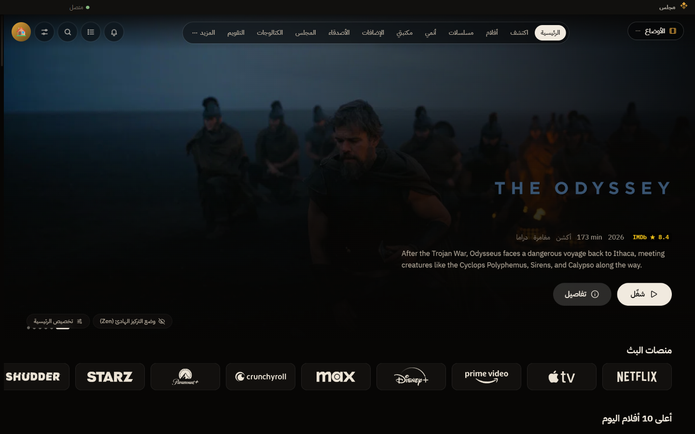
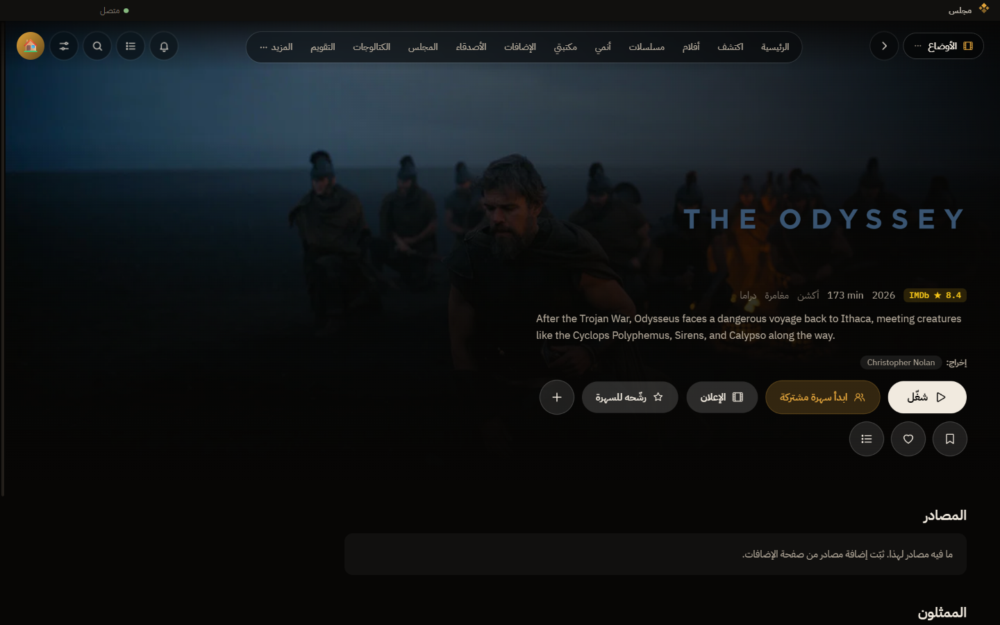
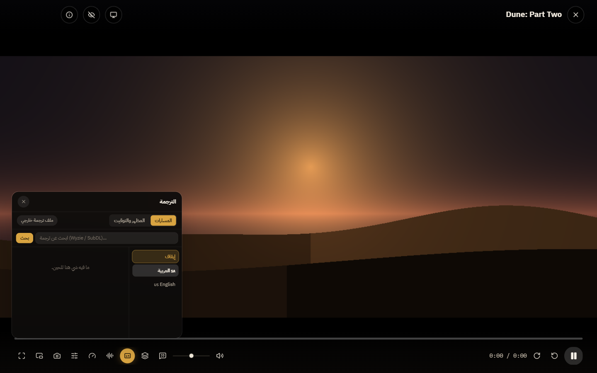
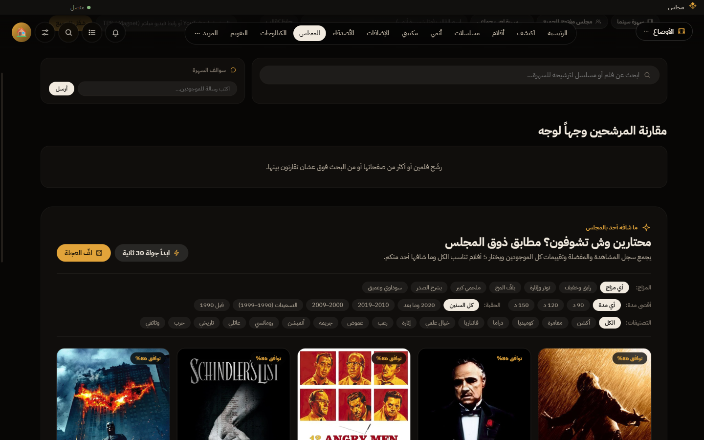
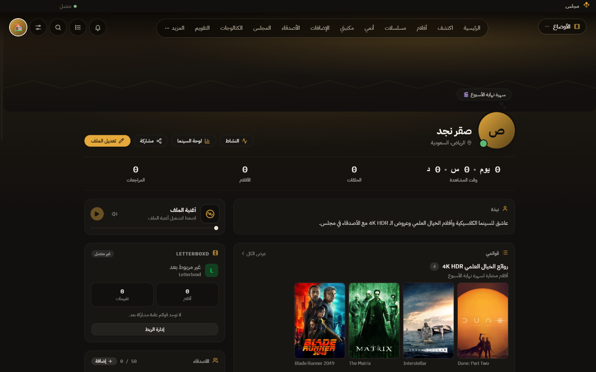
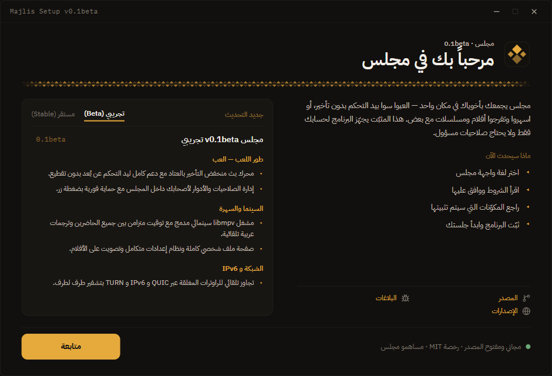
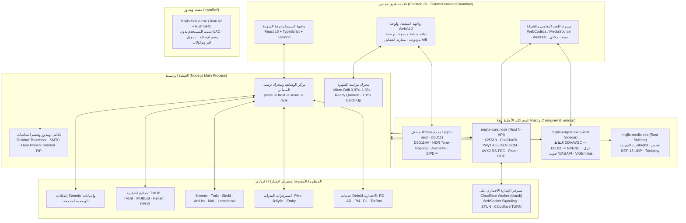

<div align="center">
<a name="readme-top"></a>

[English](README.md) &middot; **العربية**

<br/>


<br/>

<picture>
  <source media="(prefers-color-scheme: dark)" srcset="/docs/media/majlis-wordmark-dark.svg">
  <source media="(prefers-color-scheme: light)" srcset="/docs/media/majlis-wordmark-light.svg">
  
</picture>

### مركز السينما والترفيه المنزلي الأول على ويندوز — للمشاهدة الفردية، وسهرات المشاهدة الجماعية، واللعب التعاوني عن بُعد!

يجمع مشغّل `libmpv` السينمائي المدمج، ومحرك ترتيب المصادر والإضافات ذي الـ 8 طبقات، وغرفة **السهرة المشتركة (Watch Party)** المتزامنة إطاراً بإطار، وطور **اللعب التعاوني (Co-op Play)** بالعتاد بأقل تأخير ممكن، وتعتيم الشاشات الثانوية، والنافذة العائمة (PiP)، والملفات الشخصية القابلة للتخصيص — ويعمل **مباشرة فور التثبيت بدون أي سيرفر أو حساب**.

<br/>

[![Version][badge-version]][releases] &nbsp;
[![License][badge-license]][license] &nbsp;
[![Electron][badge-electron]][electron] &nbsp;
[![React + TS][badge-react]][react] &nbsp;
[![Rust core][badge-rust]][rust] &nbsp;
[![Tauri 2 Setup][badge-tauri]][tauri] &nbsp;
[![Windows][badge-windows]][releases]

<br/>

[لماذا مجلس؟](#لماذا-مجلس) &middot; [جولة في المزايا](#جولة-في-المزايا) &middot; [محرك المصادر](#محرك-ترتيب-المصادر-والإضافات) &middot; [مشغل السينما](#مشغل-السينما-المدمج-libmpv) &middot; [سهرة المشاهدة](#غرفة-السهرة-المشتركة-watch-party) &middot; [اللعب التعاوني](#طور-اللعب-التعاوني-co-op-play-وشبكات-السعودية) &middot; [الخصوصية والأمان](#الخصوصية-والأمان) &middot; [التثبيت](#التثبيت-majlis-setupexe) &middot; [المعمارية](#المعمارية-البرمجية) &middot; [الأسئلة الشائعة](#الأسئلة-الشائعة)

</div>

<p align="center">
  
  <br/>
  <sub>واجهة مجلس عند التشغيل: بانر سينمائي متحرك، وصف متابعة المشاهدة، وقائمة أعلى 10 أعمال اليوم، وشريط منصات البث بهوية الأوبسيديان والذهب الدافئ. يعمل 100% بشكل مستقل فور التثبيت بدون أي سيرفر أو حساب.</sub>
</p>

> [!IMPORTANT]
> **مجلس (Majlis)** هو مشغّل وسائط حر ومفتوح المصدر، وعميل لبروتوكول إضافات Stremio المفتوح، وتطبيق سطح مكتب مشفّر من طرف لطرف للمشاهدة الجماعية واللعب التعاوني. التطبيق **لا يستضيف ولا يفهرس ولا يوزّع أي محتوى إعلامي**، كما **لا يضم أي إضافات محتوى مدمجة**. استخدمه فقط مع وسائطك الخاصة والمصادر التي تملك صلاحية الوصول إليها. راجع [إخلاء المسؤولية](#إخلاء-المسؤولية).
> مجلس مشروع شغف غير ربحي بالكامل. إذا واجهت أي مشكلة أو كان لديك اقتراح، يسعدنا فتح [بلاغ في صفحة Issues][issues]. وبما أن المثبّت الرسمي (`Majlis-Setup.exe`) مجاني ومفتوح المصدر بالكامل ولا يحمل شهادة توقيع تجارية مدفوعة، فقد تظهر نافذة Windows SmartScreen عند التشغيل لأول مرة — أو يمكنك [بناء نسختك الخاصة من المصدر](#الإعدادات-والبناء-من-المصدر) خلال دقائق.

تنبيه هام: مشروع **مجلس** لا يطلب ولن يطلب منك أي تبرعات أو اشتراكات مالية! إذا ادّعى أي شخص أنه يمثلنا وطلب دعماً مالياً فهو لا يمتّ لنا بصلة. هل واجهت خطأً؟ افتح [بلاغاً على GitHub][issues] ليتمكن الجميع من متابعة حله. وإذا رغبت في التبرع لجهة خيرية، يمكنك دعم [منظمة EFF](https://www.eff.org/) أو الجمعيات الخيرية الصحية المعتمدة.
<br/>
<br/>
مجلس مشروع برمجي مفتوح المصدر وليس كياناً تجارياً. نحن لا نتربّح منه ولا نقبل أي أموال مقابله، ولا نوفر أي محتوى أو نرشدك لكيفية الحصول عليه؛ هو مجرد كود برمجي في مستودع عام، ولا يتحمل المساهمون فيه أي مسؤولية عن كيفية استخدامك له أو الإضافات والمصادر التي تقوم بإعدادها. التزم دائماً بالقوانين المعمول بها في بلدك.
<br/>
<br/>

<details>
<summary><kbd>جدول المحتويات</kbd></summary>

<br/>

- [لماذا مجلس؟](#لماذا-مجلس)
- [جولة في المزايا](#جولة-في-المزايا)
  - [الغرف والأقسام](#الغرف-والأقسام)
  - [محرك ترتيب المصادر والإضافات](#محرك-ترتيب-المصادر-والإضافات)
  - [تكامل السيرفرات المنزلية وحسابات التتبع](#تكامل-السيرفرات-المنزلية-وحسابات-التتبع)
  - [مشغل السينما المدمج (`libmpv`)](#مشغل-السينما-المدمج-libmpv)
  - [غرفة السهرة المشتركة ("سهرة")](#غرفة-السهرة-المشتركة-watch-party)
  - [طور اللعب التعاوني ("اللعب") وشبكات السعودية](#طور-اللعب-التعاوني-co-op-play-وشبكات-السعودية)
  - [الملفات الشخصية والسمات ومزايا جودة الحياة](#الملفات-الشخصية-والسمات-ومزايا-جودة-الحياة)
- [الخصوصية والأمان](#الخصوصية-والأمان)
- [التثبيت (`Majlis-Setup.exe`)](#التثبيت-majlis-setupexe)
- [الإعدادات والبناء من المصدر](#الإعدادات-والبناء-من-المصدر)
- [المعمارية البرمجية](#المعمارية-البرمجية)
- [خارطة الطريق](#خارطة-الطريق)
- [الأسئلة الشائعة](#الأسئلة-الشائعة)
- [إخلاء المسؤولية](#إخلاء-المسؤولية)
- [شكر وتقدير](#شكر-وتقدير)
- [الرخصة](#الرخصة)

</details>

<br/>

## لماذا مجلس؟

يجمع **مجلس (Majlis)** بين مركز سينما منزلي فاخر بهوية **الأوبسيديان الدافئ والذهب (Warm Obsidian & Gold)**، وغرفة **سهرة مشاهدة جماعية ("سهرة")** متزامنة، وغرفة **لعب تعاوني ("اللعب")** مسرّعة بالعتاد في تطبيق ويندوز واحد — دون إجبارك على إنشاء حساب مركزي أو استئجار سيرفر أو التنقل بين ثلاثة برامج مختلفة.

- **مشاهدة سينمائية فردية تعمل 100% بدون سيرفر (Server-Optional Solo Cinema):** شغّل مجلس مباشرة بعد التثبيت وتصفّح الكتالوجات، وثبّت إضافات Stremio، ونظّم مكتبتك، وتابع مواعيد الحلقات في التقويم، وشاهد بدقة 4K HDR عبر مشغّل `libmpv` المدمج **بدون أي إعدادات سيرفر، وبدون أي محاولات اتصال في الخلفية، وبدون أي تنبيهات مزعجة**. لا يُطلب سيرفر الإشارة إلا عندما تختار بنفسك استضافة أو دخول جلسة جماعية.
- **مشغّل `libmpv` مدمج داخل نفس النافذة:** يرسم `libmpv` الحقيقي (`vo=gpu-next` مع `d3d11` و `hwdec=d3d11va`) الفيديو مباشرة داخل نافذة التطبيق مع مزامنة دقيقة لمعدل الإطارات (`23.976 fps` على شاشات `60/120/144/240 Hz`)، وتحويل ألوان HDR إلى SDR بمعيارَي `bt.2446a` و `bt.2390`، وتظليل الأنمي (`Anime4K` و `FSR` و `CAS`)، وتمرير الصوت المحيطي (`TrueHD` / `Atmos` / `DTS-HD MA`)، وقوائم عائمة مدمجة وأنيقة لا تحجب الصورة.
- **محرك ذكي لترتيب المصادر من 4 مراحل (`parse -> trust -> score -> rank`):** يستعلم من جميع الإضافات بالتوازي، ويستبعد النسخ المزيفة أو غير المطابقة عبر `trustGate` (مع ميزة إنقاذ الإصدارات السينمائية الحديثة)، ويصنّف الروابط في 8 طبقات جودة (`4K Dolby Vision` حتى `SD`)، ويفحص صحة التورنت عبر `BEP-15 UDP` في الخلفية، ويختار أسرع مصدر يناسب سرعة اتصالك وتوفّر الترجمة أو الدبلجة العربية وسرعة أبطأ مشاهد في السهرة.
- **غرفة سهرة ("سهرة") مصممة لحسم حيرة الاختيار:** رشّح الأفلام ليضعها مجلس في **جدول مقارنة وجهاً لوجه (Head-to-Head Matrix)** يعرض تقييمات IMDb و Rotten Tomatoes و Letterboxd و MAL والمدة والسنة ومن شاهد الفيلم من أصدقائك، أو دع **مطابق ذوق المجلس (Group Taste Matcher)** يقترح 5 أفلام لم يشاهدها أحد في الغرفة وتناسب ذوق الجميع، أو ابدأ **جولة تصويت سريعة لمدة 30 ثانية (Quick Swipe)**، أو لفّ **عجلة الحسم (Tie-Breaker Wheel)**. وأثناء التشغيل، يضمن التصحيح الدقيق للسرعة (`0.97x–1.03x`) ونظام جاهزية البفر (`Ready Quorum`) وعدّاد `3-2-1` والتسريع الذكي (`1.15x`) بقاء الجميع على نفس اللقطة تماماً.
- **لعب تعاوني ("اللعب") مصمم لشبكات الجيل الخامس والـ CGNAT في السعودية:** يلتقط المحرك الأصلي بلغة Rust (`majlis-engine.exe`) الشاشة أو نافذة اللعبة عبر **Desktop Duplication (DDA)** أو **Windows Graphics Capture (WGC)** مباشرة إلى **D3D11 ثم NVENC / AMF / QuickSync** دون نسخ للمعالج، ويعزل صوت اللعبة وحدها عبر **WASAPI Process Loopback**، ويوصل حتى 4 يدات تحكم افتراضية عبر **ViGEmBus (Xbox 360 / DualShock 4)** مع دعم الجيروسكوب واللمس ليدات DualSense. وتتكفل نواة الشبكة (`majlis-core.node`) بتشفير كل حزمة (`AES-256-GCM` / `ChaCha20-Poly1305`)، وتصحيح الفقد الفوري (`AVX2 Reed-Solomon FEC`)، وتنظيم الإرسال (`Pacer` + `NACK` + `GCC`)، والمفاضلة التلقائية بين **IPv6 المباشر** وثقب **IPv4 UDP** و**Cloudflare TURN** مع محسّن مسارات مخصص لشبكات **STC وموبايلي وزين**.
- **دعم أصيل للعربية (RTL) والإنجليزية (LTR):** تصميم ثنائي الاتجاه بالكامل بخطوط `IBM Plex Sans Arabic` و `IBM Plex Mono`، وإصلاح تلقائي لترميز الترجمات العربية `Windows-1256` إلى `UTF-8` مع ضبط علامات الترقيم (`sub-rtl.js`)، وتبديل فوري بين السينما واللعب بضغطة `Alt+M`.

<p align="right"><a href="#readme-top">&#9650; العودة للأعلى</a></p>

## جولة في المزايا

<table>
<tr>
<td width="33%" valign="top">

**السينما والاستكشاف**

ثلاث عشرة غرفة وعرضاً مخصصاً (`الرئيسية`، `اكتشف`، `أفلام`، `مسلسلات`، `أنمي`، `مكتبتي`، `الإضافات`، `الأصدقاء`، `المجلس/سهرة`، `الكتالوجات`، `التقويم`، `السلاسل`، `التنزيلات`)، مع صفحات تفصيلية للأعمال والممثلين والمخرجين، وفلترة ذكية مركّبة للمكتبة بالعربية والإنجليزية، ووضع الواجهة الهادئة (`Zen Mode`).

</td>
<td width="33%" valign="top">

**مشغّل `libmpv` السينمائي**

مشغّل `libmpv` مدمج بمعمارية `gpu-next` و `D3D11`، وتحويل ألوان HDR، وتظليل `Anime4K`، وتعتيم الشاشات الثانوية (`0–100%`)، ونافذة عائمة دائماً في المقدمة (`PiP`)، وترجمة مزدوجة، وإصلاح تلقائي للترجمة العربية، ومُعادل وضوح الحوارات، ومقارنة تظليل الشاشة جنباً إلى جنب (`A/B Split`)، وحفظ مقاطع `15/30` ثانية.

</td>
<td width="33%" valign="top">

**السهرة واللعب التعاوني**

سهرات مشاهدة متزامنة مع جدول مقارنة المرشحين وجهاً لوجه، ومطابق ذوق المجموعة، وتمرير الريموت، والتقييم السري بعد الفيلم — بالإضافة إلى بث ألعاب بسرعة `60–120 fps` بالعتاد مع توصيل 4 يدات تحكم عن بُعد وستارة خصوصية تلقائية عند `Alt+Tab`.

</td>
</tr>
</table>

<table>
<tr>
<td width="50%" align="center">
<br/>
<sub><b>صفحة التفاصيل</b> &middot; خلفيات عالية الدقة، وتقييمات IMDb، وشارات المخرجين والممثلين القابلة للنقر، ومعاينة الإعلان، وترشيح الفيلم للسهرة، والتشغيل الفوري أو اليدوي للمصادر.</sub>
</td>
<td width="50%" align="center">
<br/>
<sub><b>مشغل السينما (libmpv)</b> &middot; نوافذ منبثقة زجاجية مدمجة (&le;50vh) فوق شريط التحكم، وترجمة مزدوجة، وبحث فوري في Wyzie/SubDL، وملفات لونية لشاشات OLED/HDR.</sub>
</td>
</tr>
<tr>
<td width="50%" align="center">
<br/>
<sub><b>غرفة السهرة (&ldquo;سهرة&rdquo;)</b> &middot; مقارنة المرشحين وجهاً لوجه، ومطابق ذوق المجلس مع نسب التوافق، وجولة التصويت السريع (30 ثانية)، وعجلة الحسم.</sub>
</td>
<td width="50%" align="center">
<br/>
<sub><b>الملف الشخصي المخصص</b> &middot; بطاقات عرض بهوية الأوبسيديان والذهب، وقوائم 4K HDR المميزة، وأغنية الملف، وربط Letterboxd/Trakt، ولوحة إحصائيات السينما الشخصية.</sub>
</td>
</tr>
<tr>
<td colspan="2" align="center">
<br/>
<sub><b>المثبّت الرسمي Majlis-Setup.exe (Tauri v2)</b> &middot; مثبّت ويندوز مخصص بزخارف السدو الهندسية، وتثبيت لحساب المستخدم بدون صلاحيات مسؤول (Zero-UAC)، وسجل تحديثات تفاعلي.</sub>
</td>
</tr>
</table>

<br/>

### الغرف والأقسام

ينظّم مجلس مكتبتك وجلساتك في غرف واضحة يمكن الوصول إليها من الشريط الزجاجي العلوي أو عبر لوحة الأوامر السريعة `Ctrl+K`.

| الغرفة | ماذا تقدّم لك |
| --- | --- |
| **الرئيسية (`Home`)** | بانر سينمائي متحرك لأبرز الأفلام والمسلسلات &middot; صف **متابعة المشاهدة** مع شريط التقدم &middot; شريط **منصات البث (`Your Services`)** بشعارات متجهة نقية (`Netflix`، `Apple TV+`، `Prime Video`، `Disney+`، `Max`، `Crunchyroll`، `Paramount+`، `Starz`، `Shudder`) &middot; صفوف **أعلى 10 اليوم** &middot; أداة تخصيص ترتيب وإظهار الصفوف &middot; زر **وضع التركيز الهادئ (`Zen Mode`)** |
| **اكتشف (`Discover`)** | توصيات ذكية تتكيّف مع تقييماتك (`أعجبني`، `لم يعجبني`، `لم أشاهده`) &middot; فلاتر المزاج والحقبة والتصنيف &middot; زر **فاجئني (`Surprise Me`)** &middot; وسلاسل **ماراثون السهرة** |
| **الكتالوجات (`Catalogs`)** | تصفّح مباشر لجميع الكتالوجات التي توفرها إضافات Stremio المثبتة لديك مع فلترة حسب النوع والتصنيف |
| **أفلام ومسلسلات (`Movies & Shows`)** | غرف مخصصة للأفلام والمسلسلات مع بانر الأعمال الرائجة، وأعلى 10 اليوم، وصفوف التصنيفات، وخيار إخفاء الأعمال المشاهَدة أو غير الصادرة بعد |
| **أنمي (`Anime`)** | غرفة متكاملة للأنمي تدمج قوائم **Kitsu** و **AniList** و **MyAnimeList (MAL)** الرائجة والموسمية مع مطابقة ذكية لمعرّفات الحلقات |
| **التقويم (`Calendar`)** | جدول مواعيد عرض حلقات **مكتبتي** و**المسلسلات التلفزيونية** و**الأفلام الجديدة** (`اليوم`، `هذا الأسبوع`، `هذا الشهر`) مع إزالة التكرار عبر TVMaze و TMDB |
| **مكتبتي (`My Library`)** | قائمة المتابعة، والمفضلة، وقيد المشاهدة، والسجل الكامل &middot; **محرك فلترة ذكي باللغة الطبيعية والمركّبة** بالعربية والإنجليزية (مثل: `أكشن التسعينات أعلى من 7 غير مشاهد` أو `sci-fi 90s 7.5+ unwatched <2h`) &middot; قوالب فلترة سريعة &middot; وفحص وإصلاح ذاتي للمكتبة |
| **السلاسل والتنزيلات (`Collections & Downloads`)** | سلاسل الأفلام الكاملة مرتبة زمنياً مع نسبة إنجاز السلسلة &middot; ومدير تنزيلات مدمج يدعم استئناف ملفات `.part` وتحديد العدد المتزامن وإيقاف/استئناف الكل |
| **الإضافات (`Addons`)** | متجر إضافات المجتمع، وتثبيت فوري عبر روابط `stremio://` أو `manifest.json`، وترتيب الأولوية، و**مراقب صحة وزمن استجابة الإضافات (`Ping & p90 Latency`)** |
| **الأصدقاء والسهرة (`Friends & Party`)** | **بطاقات صداقة موقّعة رقمياً (`Ed25519`)** تعمل بدون إنترنت (`majlis://friend/...` و `MAJLIS-F1:` مع رمز QR)، وقوالب غرف سريعة بضغطة زر، ومشاهدة روابط يوتيوب/الفيديو المباشر معاً، والتصويت، وجدول المقارنة وجهاً لوجه، ومطابق ذوق المجلس |
| **طور اللعب (`Play Mode`)** | انتقال فوري بضغطة `Alt+M` إلى غرفة اللعب التعاوني: رقم جهازك المكون من 9 خانات، وكود جلسة مؤقت من 6 خانات، واختيار الشاشة أو نافذة اللعبة، وتوزيع مقاعد اليدات (1–4)، وتمرير الدور (`Hot-Seat`) |
| **الملف الشخصي والإعدادات (`Profile & Settings`)** | ملف شخصي قابل للتخصيص مع **لوحة إحصائيات السينما (`Cinema Analytics Dashboard`)**، ومبدّل حسابات متعددة مع قفل `PIN`، و**وضع التصفح الخاص (`Incognito`)**، ونافذة إعدادات شاملة تضم **92 صفحة قابلة للبحث** |

> [!TIP]
> اضغط `Ctrl+K` في أي مكان داخل السينما لفتح **لوحة الأوامر السريعة (Command Palette)** للبحث الفوري أو الانتقال بين الغرف، أو اضغط `Alt+M` للتبديل الفوري بين **السينما** و**طور اللعب**.

<p align="right"><a href="#readme-top">&#9650; العودة للأعلى</a></p>

### محرك ترتيب المصادر والإضافات

عند الضغط على تشغيل، يستعلم مجلس من جميع إضافات المصادر بالتوازي (مع قاطع دائرة ذكي يتجاوز العناوين المحلية المتوقفة فوراً) ويمرّر كل رابط عبر أربع مراحل في `app/src/main/media/ranking.js`:

```text
parse (استخراج الخصائص)  ->  trust (بوابة الموثوقية)  ->  score (التقييم حسب الخط والسهرة)  ->  rank (8 طبقات جودة)
```

| المرحلة | ماذا يحدث فيها |
| --- | --- |
| **1. التحليل (`Parse`)** | استخراج الدقة (`2160p`، `1080p`، `720p`، `480p`)، ونوع الـ HDR (`Dolby Vision`، `HDR10+`، `HDR10`، `HLG`)، وترميز الفيديو (`AV1`، `HEVC`، `H.264`)، ومستوى الصوت (`Atmos`، `TrueHD`، `DTS-HD MA`، `DD+`، `5.1/7.1`)، وشارات **الترجمة والدبلجة العربية**، وحجم الملف، وعدد الناشرين (`Seeders`)، واسم فريق الإصدار، ونسخة الفيلم (`IMAX`، `Director's Cut`، `Extended`) |
| **2. الموثوقية (`Trust Gate`)** | استبعاد روابط التورنت الميتة (`0` ناشرين)، والأحجام غير المنطقية، والحلقات أو المواسم غير المطابقة، ونسخ الكاميرا الرديئة (`CAM / TS`). يتضمن ميزة **إنقاذ الإصدارات السينمائية الحديثة (`Early-Leak Rescue`)** التي تعرض النسخ المبكرة موسومة بوضوح عند عدم توفر نسخ رقمية بعد |
| **3. التقييم (`Score`)** | يوازن بين الجاهزية الفورية (**Debrid المخزّن / الروابط المباشرة / السيرفر المنزلي** مقابل التورنت)، وتوافق الشاشة مع HDR، وجودة الصوت، وتفضيل اللغة العربية، و**تناسب معدل البت مع سرعة خطك الفعلية وأبطأ خط بين الحاضرين في السهرة** لمنع التقطيع، مع تفضيل **نفس ملف الإصدار** الذي يشغّله المضيف |
| **4. الترتيب (`Rank`)** | يصنّف النتائج في 8 طبقات جودة واضحة (`4K Dolby Vision`، `4K HDR`، `4K SDR`، `1080p HDR`، `1080p`، `720p`، `SD`، `Rough`) مع عرض النتائج تدريجياً فور استجابة كل إضافة |

- **نقطة صحة التورنت المباشرة (`BEP-15 UDP Health Dot`):** يفحص `torrent-health.js` متتبعات الـ UDP في الخلفية ويعرض نقطة حالة ملونة (`أخضر / أصفر / أحمر`) بعدد الناشرين الفعليين دون تأخير بدء التشغيل.
- **التحويل التلقائي الذكي عند التوقف (`Smart Auto-Failover`):** إذا توقف البث لأكثر من 10 ثوانٍ أو انعدم الناشرون، يعرض المشغّل تنبيهاً مع عدّ تنازلي للانتقال التلقائي إلى أفضل مصدر بديل عند نفس الثانية تماماً.
- **دعم خدمات الـ Debrid الاختيارية:** تكامل مباشر مع **Real-Debrid** و **AllDebrid** و **Premiumize** و **Debrid-Link** و **TorBox**، بالإضافة إلى محرك التورنت المدمج `librqbit` في `majlis-media.exe` الذي يعمل بدون أي اشتراك.

<p align="right"><a href="#readme-top">&#9650; العودة للأعلى</a></p>

### تكامل السيرفرات المنزلية وحسابات التتبع

يربط مجلس سيرفراتك المنزلية وحسابات التتبع في مكتبة واحدة مع إبقاء جميع المفاتيح والرموز محلياً على جهازك.

| الخدمة | ماذا تضيف لمجلس |
| --- | --- |
| **البيانات الوصفية المدمجة** | تعمل فور التثبيت بدون أي مفتاح: كتالوجات الأفلام والمسلسلات والأنمي والملصقات والحلقات وتقييمات IMDb |
| **Plex و Jellyfin و Emby** | ربط سيرفرك المنزلي (`home-servers.js`) لتصفّح مكتبتك المحلية وتشغيل نسخ السيرفر مباشرة جنباً إلى جنب مع مصادر الإضافات مع مزامنة حالة المشاهدة |
| **TMDB و TVDB و MDBList و Fanart.tv و RPDB** | مفاتيح اختيارية تفتح السيرة والأعمال الكاملة للممثلين والمخرجين (`Person.tsx`)، وجدول التقييمات المتعددة، والشعارات الشفافة عالية الدقة، والملصقات المزودة بالتقييم |
| **مزامنة حساب Stremio** | استيراد ومزامنة ثنائية الاتجاه لمكتبة Stremio، ومتابعة المشاهدة، وقائمة الإضافات المثبتة |
| **Trakt و Simkl و AniList و MyAnimeList (MAL)** | تسجيل دخول سريع ومزامنة تلقائية فورية لما تشاهده (`Scrobbling` — تتوقف تلقائياً في وضع التصفح الخاص `Incognito`) واستيراد القوائم |
| **استيراد Letterboxd** | استيراد كامل لملفات تصدير Letterboxd بصيغة `.zip` أو `.csv` (`watched.csv`، `ratings.csv`، `diary.csv`، `reviews.csv`، `watchlist.csv`) ودمجها لكل فيلم |

<p align="right"><a href="#readme-top">&#9650; العودة للأعلى</a></p>

### مشغل السينما المدمج (`libmpv`)

يدمج مجلس مكتبة `libmpv` مباشرة داخل نافذة التطبيق (`app/src/main/libmpv.js` + `engine/majlis-core/src/mpv_render.rs` + `app/src/main/mpv.js`) ليعمل الفيديو والترجمات العربية الاحترافية وواجهة التحكم الزجاجية في نافذة واحدة متناغمة دون أي نوافذ خارجية منفصلة.

| القدرة | التفاصيل |
| --- | --- |
| **الرسم ومزامنة الإطارات** | `vo=gpu-next` / `libmpv` مع `d3d11`، وفك تشفير عتادي `hwdec=d3d11va` / `d3d11va-copy`، و `d3d11-flip=yes`، و `video-sync=display-resample`، و `interpolation=yes`، و `tscale=oversample` لعرض سينمائي فائق السلاسة (`23.976 fps`) على الشاشات السريعة |
| **ملفات HDR والتظليل والشاشات** | كشف تلقائي لنوع الشاشة (`OLED`، `HDR`، `IPS`، `Standard`) مع ضبط `bt.2446a` و `bt.2390`، ودعم `NVIDIA RTX VSR`، وتظليل **Anime4K / FSR / CAS**، وتدفئة الألوان لراحة العين، وإضاءة محيطية، و**مقارن التظليل التفاعلي جنباً إلى جنب (`A/B Split-Screen`)** |
| **تعتيم الشاشات الثانوية (`Cinema Dimmer`)** | يعتّم الشاشات الإضافية تدريجياً (`0%–100%` عبر `dimmer.js`) أثناء تشغيل الفيلم لتعيش أجواء قاعة السينما، ويعيد الإضاءة تلقائياً عند الإيقاف المؤقت أو الخروج |
| **نافذة مشاهدة عائمة حقيقية (`PiP`)** | وضع النافذة المصغّرة (`mini`) يثبّت الفيديو دائماً في المقدمة بأبعاد الفيلم الأصلية مع عناصر تحكم تظهر عند التمرير وزر قفل |
| **ترجمة مزدوجة وهندسة عربية متقدمة** | عرض **ترجمتين في نفس الوقت (`Dual Subtitles`)**، وتحويل تلقائي لترميز **Windows-1256 إلى UTF-8** مع عزل علامات الترقيم وشرطات الحوار العربية (`sub-rtl.js`)، وتشكيل `libass` الكامل (`--sub-ass-shaper=complex`)، وبحث فوري داخل المشغّل عبر **Wyzie و SubDL و OpenSubtitles**، وفلتر `SDH`، وتحكم فوري بالخط واللون والحدود والشفافية والموضع والتوقيت (`±0.1s`) |
| **الهندسة الصوتية ووضوح الحوار** | **تمرير الصوت المحيطي الخام (`S/PDIF & HDMI Bitstream Passthrough`)** لصيغ `TrueHD` و `Atmos` و `DTS-HD MA` و `E-AC3`، و**الوضع الليلي (`Night Mode`)**، و**مُعادل وضوح الحوارات (`Voice Clarity EQ`)**، ورفع الصوت حتى `200%`، وخفض تلقائي لصوت الفيلم عند تحدث أحد الأصدقاء في السهرة |
| **أدوات التنقل والالتقاط** | تخطي المقدمة والملخص والنهاية (`AniSkip` و `IntroDB` والفصول)، وتنبيه **مشهد ما بعد الشارة (`Post-Credits Alert`)**، وكشف الحلقات المزدوجة، ومعاينة مصغّرة على شريط التقدم، وزر **"وش قالوا؟"** (إرجاع `10` ثوانٍ مع إظهار الترجمة)، ولقطة شاشة `F12`، و**حفظ مقطع فيديو `15` أو `30` ثانية (`Alt+F10`)**، وتكرار `A/B`، ومؤقت نوم، وقص الشاشات العريضة `21:9`، ونقل النافذة بين الشاشات |
| **تكامل شريط مهام ومفاتيح ويندوز** | أزرار تحكم حية في معاينة شريط مهام ويندوز (`thumbar.js` — تقديم/تأخير `10` ثوانٍ وإيقاف/تشغيل) وتكامل كامل مع أزرار الوسائط في لوحة المفاتيح وواجهة **Windows SMTC** (`useMediaSession.ts`) |

<p align="right"><a href="#readme-top">&#9650; العودة للأعلى</a></p>

### غرفة السهرة المشتركة (`Watch Party` — "سهرة")

استضف أو ادخل غرفة سينما متزامنة مع أصدقائك عبر رقم مجلس المكون من 9 خانات، أو كود الغرفة المؤقت من 6 خانات، أو رابط دعوة `majlis://`.

- **مزامنة الساعة الدقيقة ونظام جاهزية البفر (`sync.js`):** بدلاً من القفزات المزعجة، يقوم المشغّل بتصحيح أي فرق زمني بين `80 ms` و `1.5 s` عبر تعديل طفيف لسرعة التشغيل (`0.97x–1.03x`) مع الحفاظ على طبقة الصوت؛ ولا يقفز إلا عند تجاوز `1.5 s`. وقبل بدء العرض، ينتظر نظام **Ready Quorum** اكتمال تخزين `>= 3` ثوانٍ لدى جميع الحاضرين ويعرض نسبة جاهزية كل صديق ثم يطلق **عدّاً تنازلياً صوتياً وبصرياً (`3-2-1`)**.
- **التسريع الذكي للحاق بالغرفة (`1.15x Catch-Up`) واستراحة `BRB`:** يمكن لمن يتأخر بسبب الشبكة اللحاق بالبث بسلاسة بسرعة `1.15x` دون قطع المشهد، كما يمكن لأي حاضر طلب **توقف مؤقت (`BRB Pause`)** لمدة محددة (`1` أو `3` أو `5` دقائق) مع عدّاد واضح للجميع.
- **حارس تطابق النسخ (`Edition & Cut Mismatch Guard`):** يقارن مدة الفيلم ووسوم النسخة (`Extended`، `Director's Cut`، `Theatrical`، `IMAX`) مع نسخة المضيف وينبّه فوراً إذا اختار أحد الضيوف نسخة مختلفة.
- **تمرير الريموت (`Pass the Remote`):** يحدد المضيف صلاحية التحكم بالتشغيل بين **المضيف فقط** أو **صديق محدد** أو **مفتوح للجميع** مع إشعار فوري باسم من قام بالإيقاف أو التقديم.
- **التصويت وجدول المقارنة وجهاً لوجه (`Head-to-Head Comparison Matrix`):** رشّح أي فيلم ليُنشئ مجلس جدول مقارنة يعرض جنباً إلى جنب: **تقييمات IMDb و Rotten Tomatoes و Letterboxd و MAL، وعدد المصوتين، وسنة الإصدار، والمدة، والتصنيف العمري، والتصنيفات المشتركة، ومن شاهده أو قيّمه من أصدقائك** مع تمييز الكفة الأفضل في كل صف.
- **مطابق ذوق المجلس (`Group Taste Matcher` — "محتارين وش تشوفون؟"):** يحلل سجل المشاهدة والمفضلة والتقييمات لجميع الموجودين في الغرفة ليقترح **5 أفلام لم يشاهدها أي شخص في المجلس** مرتبة حسب نسبة توافق الذوق (`% Taste Match`) مع فلاتر **المزاج** و**أقصى مدة** و**الحقبة الزمنية** والتصنيفات المتعددة، بالإضافة إلى **جولة التصويت السريع (30 ثانية)** و**عجلة الحسم المتزامنة**.
- **تفاعل حي وطقوس ما بعد الفيلم:** مؤشرات ماوس ملونة بأسماء الأصدقاء، وتفاعلات طائرة على الشاشة، و**ملاحظات مرتبطة بلحظات الفيلم (`Scene Notes`)**، وقائمة تشغيل ماراثونية مشتركة، ومشاهدة روابط يوتيوب معاً، و**التقييم السري الجماعي (`Blind Party Rating`)** الذي يكشف تقييمات الجميع بعد انتهاء الفيلم، وملخص **Majlis Wrapped** الشهري.

<p align="right"><a href="#readme-top">&#9650; العودة للأعلى</a></p>

### طور اللعب التعاوني (`Co-op Play` — "اللعب") وشبكات السعودية

اضغط `Alt+M` (أو اختر طور اللعب من القائمة العلوية) لدخول غرفة اللعب التعاوني ذات التأخير المنخفض جداً — المصممة للعب الألعاب التعاونية المحلية وألعاب القتال والرياضة والقصة مع أصدقائك عبر الإنترنت وكأنكم أمام شاشة واحدة.

| المنظومة | كيف تعمل |
| --- | --- |
| **التقاط الشاشة والنافذة بدون نسخ (`majlis-engine.exe`)** | يلتقط الشاشة الكاملة عبر **DXGI Desktop Duplication (DDA)** أو نافذة اللعبة وحدها عبر **Windows Graphics Capture (`gfxcapture` / D3D11)** مع تحجيم `scale_d3d11` على كرت الشاشة مباشرة دون المرور بذاكرة المعالج |
| **ترميز عتادي فائق السرعة** | يرمّز الفيديو بصيغ **AV1 أو HEVC (10-bit / HDR10 `bt2020`) أو H.264** عبر **NVIDIA NVENC** (`ll` tune، بدون إطارات B، مع `intra-refresh` و `spatial AQ`) أو **AMD AMF** أو **Intel QuickSync** مع تبديل فوري للجودة دون قطع البث |
| **عزل صوت اللعبة فقط** | يستخدم **WASAPI Process Loopback** لالتقاط صوت عملية اللعبة المحددة فقط، بحيث لا يظهر صوت محادثاتك في ديسكورد أو تنبيهات النظام داخل البث |
| **توصيل 4 يدات تحكم افتراضية (`ViGEmBus`)** | يحاكي حتى 4 يدات **Xbox 360** أو **DualShock 4** على جهاز المضيف مع اهتزاز عكسي، وتمرير الجيروسكوب واللمس ليدات DualSense عبر WebHID، وتوزيع المقاعد (`1–4` أو مشاهد)، وتمرير الدور (`Hot-Seat Baton`)، وعرض أزرار اليد على الشاشة، وزر طوارئ لإعادة الضبط (`Alt+Shift+P` / `Ctrl+Shift+X`) |
| **ستارة الخصوصية التلقائية عند `Alt+Tab`** | فور خروج المضيف من نافذة اللعبة (`Alt+Tab`)، يرصد `majlis-engine.exe` تغيّر النافذة النشطة ويكتم صوت اللعبة ويستبدل صورة البث بستارة خصوصية حتى العودة للعبة |
| **نواة النقل المشفرة (`majlis-core.node`)** | تشفّر جميع حزم الفيديو والصوت والتحكم من طرف لطرف (`X25519` + `ChaCha20-Poly1305` / `AES-256-GCM`)، وتنظّم إرسال الإطارات الكبيرة عبر **Pacer** عالي الدقة، وتستعيد الحزم المفقودة فوراً عبر **AVX2 Reed-Solomon FEC**، وتضبط السرعة عبر **NACK + GCC** |
| **محسّن شبكات السعودية والـ 5G/CGNAT** | يختبر بالتوازي مسارات **IPv6 المباشر** وثقب **IPv4 STUN/UDP** و**Cloudflare TURN** (`net.js` و `netcheck.js`) مع محسّن مسارات وتذبذب مخصص لشبكات **STC وموبايلي وزين** |

<p align="right"><a href="#readme-top">&#9650; العودة للأعلى</a></p>

### الملفات الشخصية والسمات ومزايا جودة الحياة

- **تعدد الملفات الشخصية مع قفل `PIN`:** أنشئ ملفات شخصية محلية مستقلة لأفراد العائلة من القائمة العلوية، لكل منها مكتبته وسجل مشاهدته وسمته وقفل `PIN` اختياري من 4 أرقام.
- **وضع التصفح الخاص (`Incognito Mode`):** بضغطة واحدة من الشريط العلوي، يوقف تسجيل سجل المشاهدة، وسلسلة الأيام (`watchLog`)، ومزامنة Trakt/AniList/MAL، وعنوان الفيلم في شريط وسائط ويندوز (SMTC)، وحالة Discord Rich Presence، وينظّف الكاش المؤقت فور إغلاق المشغّل.
- **لوحة إحصائيات السينما الشخصية (`Cinema Analytics Dashboard`):** تعرض إجمالي ساعات المشاهدة، والأفلام والحلقات المكتملة، وسلسلة الأيام الحالية والأطول، ومخطط النشاط الشهري لـ 12 شهراً، ومتوسط تقييماتك، وأبرز التصنيفات والمخرجين والممثلين.
- **تخصيص الملف الشخصي والنسخ الاحتياطي المشفّر:** خصّص ملفك بالسمات والألوان وأغنية الملف وقوائم الأفلام المميزة ولوحة HTML/CSS المعزولة آمنياً (`sanitizeCanvas.ts`)، أو صدّر واستورد حزم `.majlisprofile` المشفّرة بمعيار `AES-256-GCM`.
- **مركز التشخيص والإصلاح الذاتي (`Self-Heal Diagnostics Center`):** يفحص 7 منظومات رئيسية (`المشغل`، `محرك P2P`، `الإضافات`، `الشبكة`، `الكاش`، `المكتبة`، `الترميز العتادي`) بضغطة زر مع إصلاح ذاتي فوري (`تنظيف الكاش وإعادة ضبط المشغل`) ونسخ تقرير منقّح يزيل تلقائياً أي مفاتيح أو رموز أو أسماء مستخدمين.

<p align="right"><a href="#readme-top">&#9650; العودة للأعلى</a></p>

## الخصوصية والأمان

صُمم مجلس لتبقى مفاتيحك وسجل مشاهدتك وملفاتك تحت سيطرتك الكاملة على جهازك:

- **صفر تتبع وصفر حسابات مركزية:** لا يجمع مجلس أي تحليلات ولا يرسل أي بيانات لخوادم خارجية ولا يتطلب التسجيل. هويتك هي زوج مفاتيح **Ed25519** يولَّد محلياً على جهازك.
- **تشفير المفاتيح على مستوى نظام التشغيل (`Windows DPAPI`):** يُحفظ مفتاح هويتك الخاص ورموزك الحساسة مشفّرة عبر واجهة **`safeStorage` (DPAPI)** داخل `%APPDATA%\Majlis`.
- **مستقل بالكامل عن أي نطاق مركزي (`Domain-Free`):** السينما الفردية لا تتطلب أي سيرفر. ولجلسات السهرة واللعب، يمكنك نشر سيرفر الإشارة الخفيف المرفق في المستودع (`cloud/src/worker.js` على Cloudflare Workers مجاناً، أو `server/index.js` على Node.js) على حسابك الخاص مع دعم مفتاح وصول `ACCESS_KEY` ورقم سري للغرفة `PIN` (يتم التحقق منه بتحدي `HMAC-SHA256` دون إرسال الرقم السري كنص صريح).
- **تحصين كامل لفيوزات Electron 38 وعزل العمليات:** يعمل العارض داخل بيئة معزولة (`contextIsolation: true` و `sandbox: true` و `nodeIntegration: false`) مع قائمة قنوات مسموحة صارمة (`ALLOWED_INVOKE`) في `preload.js`. كما يتم تفعيل والتحقق من جميع فيوزات الأمان الستة في كل بناء (`RunAsNode=disabled`، `EnableCookieEncryption=enabled`، `EnableNodeOptionsEnvironmentVariable=disabled`، `EnableNodeCliInspectArguments=disabled`، `EnableEmbeddedAsarIntegrityValidation=enabled`، `OnlyLoadAppFromAsar=enabled`)، مع عدم شحن أي ملفات `.map` أو مسارات مستخدم محلية داخل الملفات التنفيذية.

<p align="right"><a href="#readme-top">&#9650; العودة للأعلى</a></p>

## التثبيت (`Majlis-Setup.exe`)

حمّل المثبّت الرسمي **`Majlis-Setup.exe`** من [صفحة الإصدارات (Releases)][releases] وشغّله على **Windows 10 أو Windows 11 (x64)**.

| النظام | الحزمة | ملاحظات |
| --- | --- | --- |
| **Windows 10 / 11 (x64)** | **[`Majlis-Setup.exe`][releases]** | مثبّت Tauri v2 ذاتي الاستخراج يثبّت التطبيق في `%LOCALAPPDATA%\Majlis` لحساب المستخدم الحالي (بدون طلب صلاحيات مسؤول UAC)، مع اختصارات سطح المكتب وقائمة ابدأ وتسجيل روابط `majlis://` و `stremio://` |

> [!NOTE]
> **التشغيل لأول مرة على ويندوز (SmartScreen):** لأن مجلس مشروع مجاني ومفتوح المصدر وغير ربحي، فإن `Majlis-Setup.exe` غير موقّع بشهادة توقيع تجارية مدفوعة. إذا ظهرت نافذة Windows SmartScreen (*"Windows protected your PC"*)، اضغط **مزيد من المعلومات (More info)** ثم **التشغيل على أي حال (Run anyway)** بعد التحقق من بصمة `SHA-256` المذكورة في صفحة الإصدار، أو [ابنِ المثبّت بنفسك من المصدر](#الإعدادات-والبناء-من-المصدر).

- **مباشرة بعد التثبيت (السينما الفردية):** لا تحتاج إلى أي تعريفات إضافية أو عنوان سيرفر أو مفاتيح API. افتح مجلس واستمتع بالمشاهدة فوراً.
- **اختياري — تعريف يدات التحكم الافتراضية للعب التعاوني (`ViGEmBus`):** إذا كنت تريد **استضافة** جلسة لعب تعاوني بحيث يتحكم أصدقاؤك عن بُعد بيدات افتراضية على جهازك، ثبّت تعريف **[ViGEmBus مفتوح المصدر](https://github.com/nefarius/ViGEmBus/releases)** (يتوفر زر تحميل مباشر داخل إعدادات مجلس). الضيوف ومستخدمو السينما لا يحتاجون لتثبيته.
- **اختياري — استضافة غرف السهرة واللعب عبر الإنترنت:** لاستضافة أو دخول غرفة مشتركة، أضف عنوان سيرفر الإشارة في **الإعدادات &larr; السيرفر والربط** (أو انشر سيرفرك المجاني على Cloudflare Workers من مجلد `cloud/` في أقل من دقيقة).

<p align="right"><a href="#readme-top">&#9650; العودة للأعلى</a></p>

## الإعدادات والبناء من المصدر

تُحفظ جميع الإعدادات محلياً في `%APPDATA%\Majlis\majlis.json` ويمكن إدارتها من نافذة **الإعدادات** القابلة للبحث (`Ctrl+,`).

| الإعداد | القيمة الافتراضية | وظيفته |
| --- | --- | --- |
| `لغة الواجهة` | `العربية (RTL)` | تبديل فوري بين العربية (`RTL`) والإنجليزية (`LTR`) |
| `مفاتيح TMDB / TVDB / MDBList / Fanart / RPDB` | `فارغ` (اختياري) | إثراء البيانات المدمجة بالسير الذاتية للممثلين والمخرجين وتقييمات النقاد والشعارات الشفافة |
| `خدمة ومفتاح Debrid` | `فارغ` (اختياري) | ربط Real-Debrid أو AllDebrid أو Premiumize أو Debrid-Link أو TorBox للبث الفوري المخزّن |
| `السيرفرات المنزلية` | `فارغ` (اختياري) | ربط مكتبات Plex و Jellyfin و Emby المحلية أو البعيدة |
| `حسابات التتبع` | `غير متصل` | مزامنة ثنائية مع Stremio و Trakt و Simkl و AniList و MAL واستيراد ملفات Letterboxd |
| `الملف اللوني لشاشة العرض` | `تلقائي (Auto)` | ضبط تلقائي لتحويل ألوان HDR وتنعيم التدرج لشاشات `OLED` و `HDR` و `IPS` |
| `تعتيم الشاشات الثانوية` | `0%` (مغلق) | تعتيم الشاشات الإضافية (`0–100%`) تلقائياً أثناء تشغيل الفيديو |
| `عنوان ومفتاح سيرفر الإشارة` | `فارغ` (اختياري) | يُستخدم فقط عند استضافة أو دخول غرفة سهرة أو لعب تعاوني |

### البناء من المصدر (`Build from Source`)

يتكون المشروع من ثلاث مساحات عمل: **المحركات الأصلية بلغة Rust (`engine/`)**، و**تطبيق سطح المكتب (`app/`)**، و**مثبّت ويندوز المبني على Tauri v2 (`installer/`)**.

**المتطلبات الأساسية (`Windows 10 / 11 x64`):**
- [Node.js](https://nodejs.org/) إصدار 20 LTS أو أحدث (`npm`)
- [حزمة Rust](https://rustup.rs/) (`stable-x86_64-pc-windows-msvc`) مع أدوات بناء Visual Studio C++
- [7-Zip](https://www.7-zip.org/) (`7z` مضاف إلى `PATH`، يستخدمه `fetch-mpv.js` لفك ضغط `mpv` و `libmpv-2.dll` عند أول بناء)

<details>
<summary><b>1. بناء محركات Rust الأصلية والتشغيل في وضع التطوير</b></summary>

<br/>

```powershell
# بناء majlis-engine.exe و majlis-media.exe و majlis_core.dll (majlis-core.node)
cargo build --manifest-path engine/Cargo.toml --release --workspace

# تثبيت حزم التطبيق وبناء واجهة السينما وجلب mpv و yt-dlp ونسخ majlis-core.node
cd app
npm install
npm run media
npm run core
npm run mpv
npm run ytdlp

# تشغيل مجلس في وضع التطوير
.\node_modules\electron\dist\electron.exe .
```

</details>

<details>
<summary><b>2. تشغيل حزم الاختبارات الآلية وفحوصات الجودة</b></summary>

<br/>

```powershell
# تشغيل جميع اختبارات Node.js الـ 134 (التشفير، FEC، ترتيب المصادر، المزامنة، libmpv، الترجمة العربية، الفيوزات)
npm --prefix app test

# فحص أنواع TypeScript واختبارات Rust
npx --prefix app/media tsc --noEmit -p app/media/tsconfig.json
cargo test --manifest-path engine/Cargo.toml --release --workspace
```

</details>

<details>
<summary><b>3. حزم نسخة الإصدار وبناء المثبّت Majlis-Setup.exe</b></summary>

<br/>

```powershell
# 1. بناء واجهة المثبّت ونواة الاستخراج بلغة Rust (Tauri v2)
npm --prefix installer install
npm --prefix installer run build
cargo build --manifest-path installer/src-tauri/Cargo.toml --release

# 2. حزم التطبيق في win-unpacked (مع تفعيل الفيوزات الأمنية الستة وإزالة ملفات .map)
npm --prefix app run dist

# 3. تجميع المثبّت الذاتي Majlis-Setup.exe في ملف واحد
node installer/scripts/build-setup.mjs app/dist/win-unpacked app/dist/Majlis-Setup.exe
```

</details>

<p align="right"><a href="#readme-top">&#9650; العودة للأعلى</a></p>

## المعمارية البرمجية



<p align="right"><a href="#readme-top">&#9650; العودة للأعلى</a></p>

## خارطة الطريق

- [x] مشغّل `libmpv` سينمائي مدمج داخل نفس النافذة (`gpu-next`، `D3D11VA`، تحويل ألوان HDR، تظليل `Anime4K`)
- [x] وضع السينما الفردية بدون سيرفر بنسبة 100% دون أي تنبيهات اتصال في الخلفية
- [x] محرك ترتيب المصادر من 4 مراحل (`parse -> trust -> score -> rank`) مع 8 طبقات جودة وفحص صحة التورنت `BEP-15 UDP`
- [x] غرفة السهرة المشتركة ("سهرة") مع جدول المقارنة وجهاً لوجه، ومطابق ذوق المجلس، والتصويت السريع، وعجلة الحسم
- [x] طور اللعب التعاوني ("اللعب") مع التقاط `DDA/WGC`، وعزل صوت اللعبة `WASAPI`، وتوصيل 4 يدات `ViGEmBus`
- [x] تعتيم الشاشات الثانوية، والنافذة العائمة `PiP`، وأزرار شريط مهام ويندوز `Thumbbar`، ومفاتيح الوسائط `SMTC`
- [x] تعدد الملفات الشخصية مع قفل `PIN`، ووضع التصفح الخاص `Incognito`، ولوحة إحصائيات السينما، ومركز التشخيص والإصلاح الذاتي
- [x] مثبّت ويندوز الرسمي `Majlis-Setup.exe` المبني على Tauri v2
- [ ] توقيع رقمي رسمي للحزم التنفيذية على ويندوز
- [ ] مكتبة موسّعة لملفات التظليل والسمات المجتمعية
- [ ] تطبيق ريموت محلي اختياري للهواتف عبر الشبكة المنزلية (LAN)

<p align="right"><a href="#readme-top">&#9650; العودة للأعلى</a></p>

## الأسئلة الشائعة

**هل يوفر تطبيق مجلس أي أفلام أو مسلسلات أو إضافات محتوى؟**
لا. مجلس لا يستضيف ولا يفهرس ولا يشحن أي وسائط أو إضافات محتوى. هو مشغّل وسائط وعميل لبروتوكول إضافات Stremio المفتوح، ويعتمد التشغيل كلياً على ملفاتك المحلية أو سيرفرك المنزلي أو الإضافات التي تختار تثبيتها بنفسك.

**هل أحتاج إلى سيرفر أو حساب لاستخدام مجلس؟**
لا. طور السينما الفردي يعمل بنسبة 100% فور التثبيت بدون أي حساب وبدون إعداد أي سيرفر. تحتاج فقط لإضافة عنوان سيرفر إشارة في الإعدادات إذا رغبت في استضافة أو دخول غرفة سهرة أو جلسة لعب تعاوني مع أصدقائك عبر الإنترنت.

**هل أحتاج إلى مفتاح TMDB أو اشتراك Debrid؟**
كلاهما اختياري تماماً. البيانات الوصفية المدمجة تعمل فور التثبيت، كما تعمل الملفات المحلية والسيرفرات المنزلية (Plex/Jellyfin/Emby) والبث المباشر والتورنت بدون Debrid. إضافة مفتاح TMDB المجاني في الإعدادات يفتح صفحات الممثلين والمخرجين الكاملة وصفوف المنصات الإقليمية والشعارات الإضافية.

**لماذا تظهر نافذة Windows SmartScreen عند تشغيل `Majlis-Setup.exe`؟**
شهادات التوقيع الرقمي التجارية لويندوز (EV Code Signing) تتطلب رسوماً سنوية مرتفعة وكياناً تجارياً مسجلاً. ولأن مجلس مشروع مجاني ومفتوح المصدر وغير ربحي ويرفض التبرعات، فإن الإصدارات الجاهزة غير موقّعة تجارياً. يمكنك التحقق من بصمة `SHA-256` في [صفحة الإصدار][releases] والضغط على **More info &rarr; Run anyway**، أو بناء التطبيق والمثبّت بنفسك من المصدر.

**هل مجلس تابع لشركة Stremio أو مشروع Harbor؟**
لا. مجلس مشروع مستقل ومفتوح المصدر متوافق مع بروتوكول إضافات Stremio المفتوح، ومستلهم من روح الإتقان في مجتمع مراكز الوسائط مفتوحة المصدر.

<p align="right"><a href="#readme-top">&#9650; العودة للأعلى</a></p>

## إخلاء المسؤولية

> [!IMPORTANT]
> مجلس هو مشغّل وسائط حر ومفتوح المصدر، وعميل لبروتوكول إضافات Stremio المفتوح، وأداة بث مشفّرة من طرف لطرف. التطبيق غير تابع ولا معتمد ولا مرتبط بشركة Stremio Ltd أو أي مزوّد بث. لا يستضيف مجلس أي وسائط، ولا يفهرس أي محتوى، ولا يضم أي إضافات محتوى، ولا يوفّر أي بث خاص به، ولا يشجّع على القرصنة أو الوصول غير المصرح به للمحتوى المحمي بحقوق النشر. استخدم مجلس فقط مع الوسائط والألعاب التي تملكها أو تملك صلاحية قانونية للوصول إليها. أنت وحدك المسؤول عن اختيار الإضافات والسيرفرات والمصادر التي تضيفها، وعن التزام استخدامك بالقوانين المعمول بها في بلدك وشروط أي خدمة تربطها بالتطبيق.

<p align="right"><a href="#readme-top">&#9650; العودة للأعلى</a></p>

## شكر وتقدير

يقف مجلس على أكتاف منظومة برمجيات حرة ومفتوحة المصدر رائعة:

- **بروتوكول إضافات Stremio** ومجتمع مطوري الإضافات على بناء معيار مفتوح ومرن.
- مشاريع **Harbor** و **NuvioDesktop** و **Stremio** على إلهام تجربة مراكز الوسائط الحديثة على سطح المكتب.
- مشروع **libmpv / mpv** على محرك التشغيل السينمائي العالمي، ومشروع **Anime4K** على مرشحات التظليل الفورية.
- مشروع **ViGEmBus** (`nefarius`) لمحاكاة يدات التحكم على ويندوز، ومشروع **librqbit** لبث التورنت عالي الأداء بلغة Rust.
- خدمات **TMDB** و **TVDB** و **MDBList** و **Fanart.tv** و **RPDB** و **Kitsu** و **AniList** و **MyAnimeList** و **Trakt** و **Simkl** و **TVMaze** و **OpenSubtitles** و **Wyzie** و **SubDL** و **AniSkip** و **IntroDB**.
- مشاريع **Electron** و **Tauri** و **React** و **TypeScript** و **Tailwind CSS** و **Vite** و **Rust**.

<p align="right"><a href="#readme-top">&#9650; العودة للأعلى</a></p>

## الرخصة

مرخّص بموجب رخصة [MIT](./LICENSE) &copy; 2026 مساهمو مشروع مجلس (`ds1s1s1`).

<br/>

<div align="center">
<picture>
  <source media="(prefers-color-scheme: dark)" srcset="/docs/media/majlis-mark.svg">
  
</picture>
<br/><br/>
<sub>صُنع بعناية لسهرات السينما وجلسات اللعب مع الأصدقاء. <a href="#readme-top">&#9650; العودة للأعلى</a></sub>
</div>

<!-- reference links -->

[releases]: https://github.com/ds1s1s1/majlis/releases
[issues]: https://github.com/ds1s1s1/majlis/issues
[license]: https://github.com/ds1s1s1/majlis/blob/main/app/package.json
[electron]: https://www.electronjs.org/
[tauri]: https://v2.tauri.app/
[react]: https://react.dev/
[rust]: https://www.rust-lang.org/

<!-- badges -->

[badge-version]: https://img.shields.io/badge/version-0.1.2beta-D9A441?style=for-the-badge&labelColor=1a1a1a
[badge-license]: https://img.shields.io/badge/license-MIT-D9A441?style=for-the-badge&labelColor=1a1a1a
[badge-electron]: https://img.shields.io/badge/Electron-38-47848F?style=for-the-badge&logo=electron&logoColor=white&labelColor=1a1a1a
[badge-react]: https://img.shields.io/badge/React%2018-TypeScript-61DAFB?style=for-the-badge&logo=react&logoColor=white&labelColor=1a1a1a
[badge-rust]: https://img.shields.io/badge/core-Rust%20Engine-DEA584?style=for-the-badge&logo=rust&logoColor=white&labelColor=1a1a1a
[badge-tauri]: https://img.shields.io/badge/Setup-Tauri%202-24C8DB?style=for-the-badge&logo=tauri&logoColor=white&labelColor=1a1a1a
[badge-windows]: https://img.shields.io/badge/Windows-10%20%7C%2011%20x64-D9A441?style=for-the-badge&logo=windows&logoColor=white&labelColor=1a1a1a
