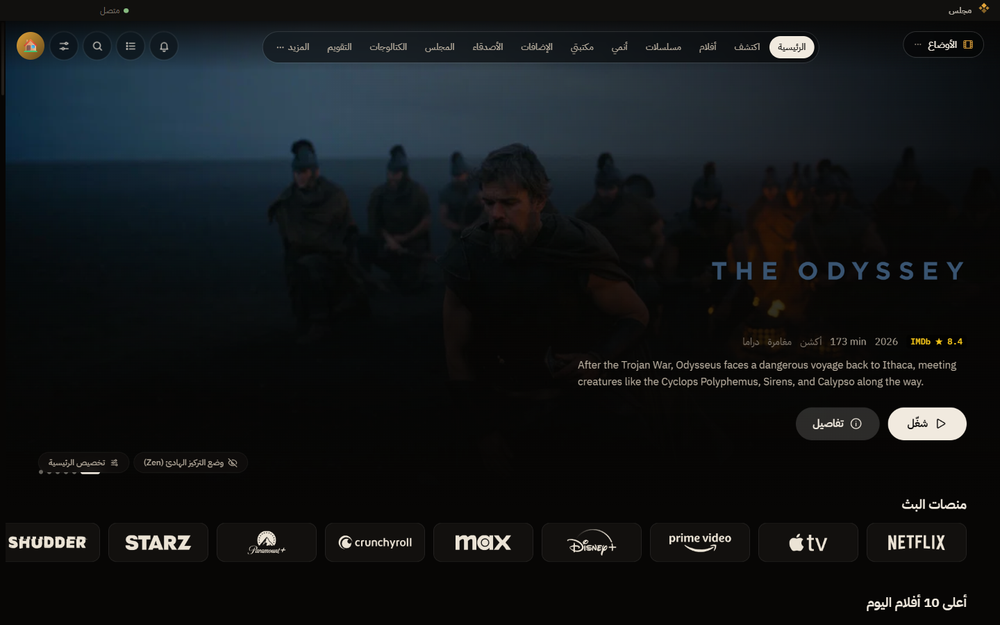
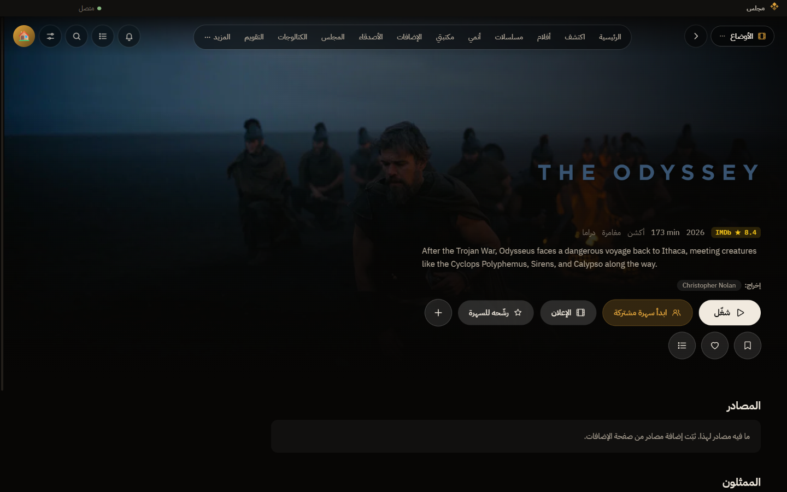
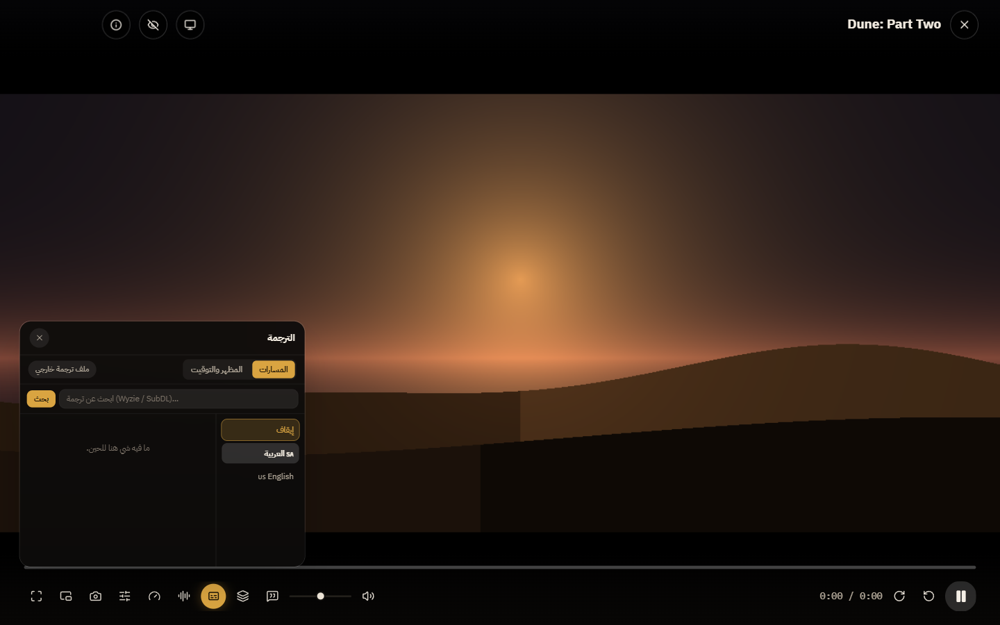
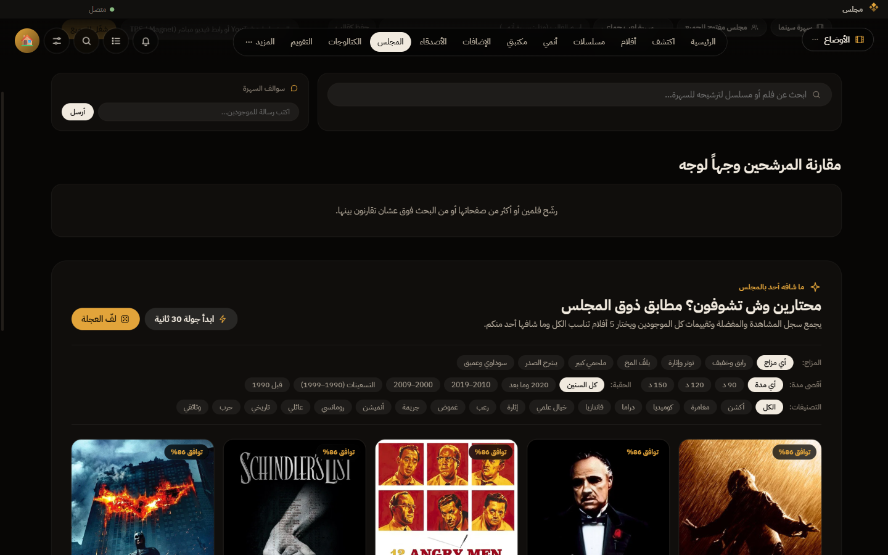
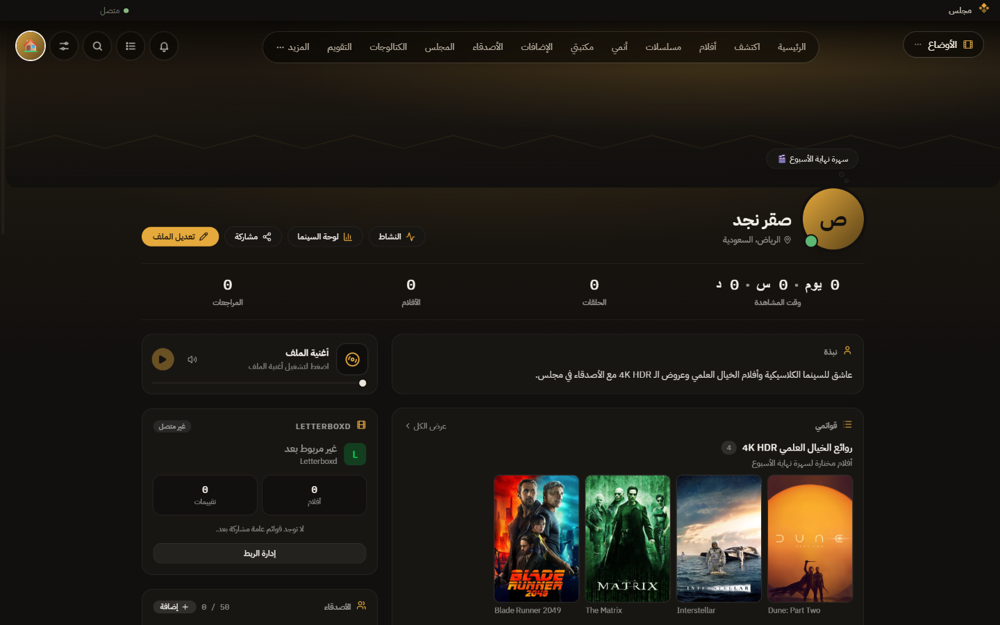
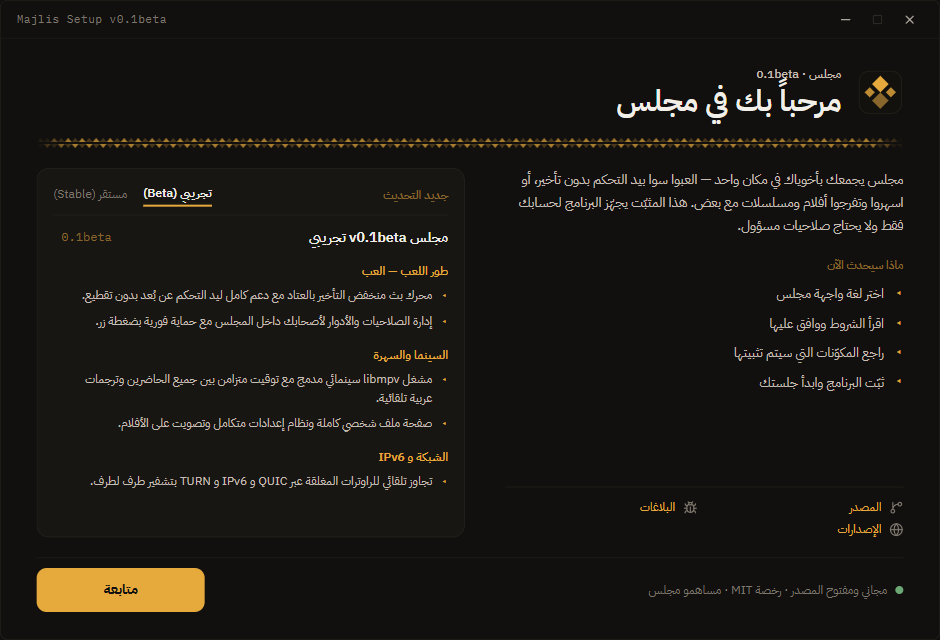
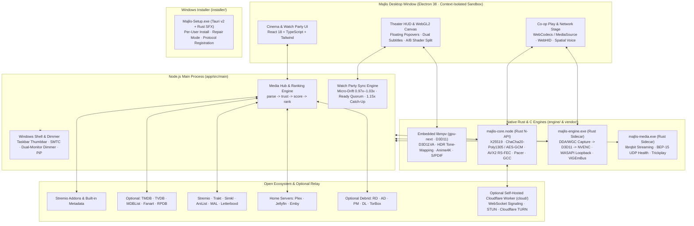

<div align="center">
<a name="readme-top"></a>

**English** &middot; [العربية](README.ar.md)

<br/>


<br/>

<picture>
  <source media="(prefers-color-scheme: dark)" srcset="/docs/media/majlis-wordmark-dark.svg">
  <source media="(prefers-color-scheme: light)" srcset="/docs/media/majlis-wordmark-light.svg">
  
</picture>

### A Cinema-First Windows Media Center Built for Solo Cinema, Watch Parties & Co-op Play!

Offering a native `libmpv` theater engine, an 8-tier stream ranking & addon pipeline, frame-accurate Watch Parties (**سهرة**), ultra-low-latency hardware Co-op Gaming (**اللعب**), Dual-Monitor Cinema Dimmer, Always-on-Top PiP, customizable community profiles, and zero-server standalone operation out of the box.

<br/>

[![Version][badge-version]][releases] &nbsp;
[![License][badge-license]][license] &nbsp;
[![Electron][badge-electron]][electron] &nbsp;
[![React + TS][badge-react]][react] &nbsp;
[![Rust core][badge-rust]][rust] &nbsp;
[![Tauri 2 Setup][badge-tauri]][tauri] &nbsp;
[![Windows][badge-windows]][releases]

<br/>

[Why Majlis](#why-majlis) &middot; [Features](#feature-tour) &middot; [Stream Engine](#the-stream-ranking--addon-engine) &middot; [Theater Player](#the-theater-player-libmpv) &middot; [Watch Party](#watch-party-سهرة) &middot; [Co-op Play](#co-op-gaming-اللعب--saudi-networks) &middot; [Privacy & Security](#privacy--security) &middot; [Install](#install-majlis-setupexe) &middot; [Architecture](#architecture) &middot; [FAQ](#faq)

</div>

<p align="center">
  
  <br/>
  <sub>Majlis on launch: a rotating cinematic billboard, Continue Watching, Top 10 Today numerals, and crisp Warm Obsidian &amp; Gold streaming service rails. Works 100% standalone out of the box with zero server or account required.</sub>
</p>

> [!IMPORTANT]
> **Majlis** is an independent, open-source media player, a client for the open Stremio addon protocol, and an encrypted peer-to-peer Watch Party & Co-op Gaming desktop app. It **hosts, indexes, and ships no media**, and it **bundles no content addons**. Use it only with your own media and sources you are authorized to access. See the [Disclaimer](#disclaimer).
> Majlis is a non-profit passion project. Please open an [issue][issues] if you encounter a bug or have feedback. Our bundled Windows installer (`Majlis-Setup.exe`) is distributed without a commercial Windows code-signing certificate (because it is a 100% free open-source project), so Windows SmartScreen may prompt on first run—or you can [build your own copy from source](#configuration--build-from-source) in minutes.

ATTENTION: MAJLIS DOES NOT AND WILL NOT ASK YOU FOR DONATIONS! If anyone claims to be us and asks for money, subscriptions, or donations, IT IS NOT US. Have a bug report or feature request? Open an [issue on GitHub][issues] so everyone can follow its resolution.
<br/>
<br/>
MAJLIS IS AN OPEN-SOURCE PROJECT AND NOT A COMMERCIAL ENTITY. WE DO NOT PROFIT OR ACCEPT MONEY FOR IT. WE DO NOT PROVIDE ANY CONTENT OR TELL YOU WHERE TO FIND IT. IT IS JUST CODE IN A REPOSITORY. ITS CONTRIBUTORS ARE NOT RESPONSIBLE FOR WHAT YOU DO WITH IT OR WHICH ADDONS AND SOURCES YOU CONFIGURE. FOLLOW ALL LAWS OF YOUR JURISDICTION.
<br/>
<br/>

<details>
<summary><kbd>Table of contents</kbd></summary>

<br/>

- [Why Majlis](#why-majlis)
- [Feature Tour](#feature-tour)
  - [Rooms & Views](#rooms--views)
  - [The Stream Ranking & Addon Engine](#the-stream-ranking--addon-engine)
  - [Home-Server & Tracker Integrations](#home-server--tracker-integrations)
  - [The Theater Player (`libmpv`)](#the-theater-player-libmpv)
  - [Watch Party ("سهرة")](#watch-party-سهرة)
  - [Co-op Gaming ("اللعب") & Saudi Networks](#co-op-gaming-اللعب--saudi-networks)
  - [Profiles, Themes & Quality-of-Life Extras](#profiles-themes--quality-of-life-extras)
- [Privacy & Security](#privacy--security)
- [Install (`Majlis-Setup.exe`)](#install-majlis-setupexe)
- [Configuration & Build from Source](#configuration--build-from-source)
- [Architecture](#architecture)
- [Roadmap](#roadmap)
- [FAQ](#faq)
- [Disclaimer](#disclaimer)
- [Acknowledgements](#acknowledgements)
- [License](#license)

</details>

<br/>

## Why Majlis

**Majlis (مجلس)** brings a luxury **Warm Obsidian & Gold** cinema media center, a synchronized **Watch Party ("سهرة")**, and a hardware-accelerated **Co-op Gaming room ("اللعب")** into a single native Windows desktop app—without forcing you to create an account, rent a central server, or juggle three separate programs.

- **100% Server-Optional Solo Cinema.** Launch Majlis right after install and browse catalogs, install Stremio addons, manage your library, track releases on the Calendar, and watch in 4K HDR on the embedded `libmpv` engine with **zero server configuration, zero background connection retries, and zero nag toasts**. A signaling relay is only ever used if you explicitly host or join a multiplayer session.
- **Embedded single-window `libmpv` Theater.** Real `libmpv` (`vo=gpu-next`, `d3d11`, `hwdec=d3d11va`) renders directly inside the application window with display-resampled frame pacing (`23.976 fps` on `60/120/144/240 Hz` monitors), HDR-to-SDR `bt.2446a` / `bt.2390` tone-mapping, Anime4K / FSR / CAS GLSL shaders, TrueHD/Atmos/DTS-HD MA S/PDIF passthrough, and compact floating glass popovers that never bury the picture.
- **Intelligent 4-stage stream ranking (`parse -> trust -> score -> rank`).** Parallel addon fan-out collects every stream offer, strips cam/fake/mismatch releases via `trustGate` (with Early-Leak Rescue for brand-new theatrical releases), classifies candidates into 8 quality tiers (`4K Dolby Vision` down to `SD`), probes live BEP-15 UDP torrent swarm health in the background, and picks the fastest high-bitrate stream—factoring in your line speed, Arabic subtitle/dub availability, and the slowest viewer in a Watch Party.
- **Watch Parties ("سهرة") built for indecisive friends.** Nominate movies into a **Head-to-Head Comparison Matrix** (IMDb, Rotten Tomatoes, Letterboxd, MAL, runtime, release year, and who in the room already watched it), run the **Group Taste Matcher** to surface 5 unseen picks that fit everyone's history, launch a **30-second Quick Swipe deck**, or spin the synced **Tie-Breaker Wheel**. During playback, micro-drift `playbackRate` nudging (`0.97x–1.03x`), Ready Quorum pre-buffering, a `3-2-1` audio countdown, and `1.15x` pitch-corrected Smart Catch-Up keep everyone frame-locked.
- **Hardware Co-op Gaming ("اللعب") engineered for Saudi 5G & CGNAT.** A dedicated Rust sidecar (`majlis-engine.exe`) captures your desktop or a single game window via **Desktop Duplication (DDA)** or **Windows Graphics Capture (WGC)** straight into **D3D11 → NVENC / AMF / QuickSync** with zero CPU copy, isolates the game's audio via **WASAPI Process Loopback**, and emulates up to 4 virtual **ViGEmBus Xbox 360 / DualShock 4** controllers (with DualSense WebHID gyro & touchpad). Our Rust N-API core (`majlis-core.node`) protects every frame with **AES-256-GCM / ChaCha20-Poly1305**, **AVX2 Reed-Solomon FEC**, a high-resolution Pacer, NACK, and GCC congestion control—automatically racing **IPv6 direct**, **IPv4 UDP hole punching**, and optional **Cloudflare TURN** with an ISP jitter profiler tuned for **STC, Mobily, and Zain**.
- **First-class Arabic RTL & English LTR craftsmanship.** Native bidirectional layout (`IBM Plex Sans Arabic` + `IBM Plex Mono`), automatic Windows-1256 to UTF-8 Arabic subtitle transcoding and punctuation shaping (`sub-rtl.js`), and instant switching between Cinema and Play modes via `Alt+M`.

<p align="right"><a href="#readme-top">&#9650; back to top</a></p>

## Feature Tour

<table>
<tr>
<td width="33%" valign="top">

**Cinema & Discovery**

Thirteen dedicated rooms and views (`Home`, `Discover`, `Movies`, `Shows`, `Anime`, `Library`, `Addons`, `Friends`, `Party`, `Catalogs`, `Calendar`, `Collections`, `Downloads`), plus deep `Detail`, `Person`, and `Entity` pages, a smart compound EN/AR library filter DSL, and a minimalist Zen Home mode.

</td>
<td width="33%" valign="top">

**Native `libmpv` Theater**

Embedded `libmpv` with `gpu-next` D3D11 rendering, HDR tone-mapping, Anime4K shaders, Dual-Monitor Cinema Dimmer (`0–100%`), True Always-on-Top PiP, Dual Subtitles, Auto Arabic encoding repair, Voice Clarity EQ, Split-Screen A/B shader comparison, and 15s/30s clip saving.

</td>
<td width="33%" valign="top">

**Watch Party & Co-op Play**

Frame-accurate Watch Parties with Head-to-Head Movie Comparison, Group Taste Matcher, Pass-the-Remote, and Blind Group Ratings—plus 60–120 fps hardware game streaming with 4-player ViGEmBus controller handoff, Alt-Tab Privacy Curtain, and zero central accounts.

</td>
</tr>
</table>

<table>
<tr>
<td width="50%" align="center">
<br/>
<sub><b>Detail page</b> &middot; high-res artwork, IMDb ratings, clickable director &amp; cast pills, trailer preview, Watch Party nomination, and instant or manual source selection.</sub>
</td>
<td width="50%" align="center">
<br/>
<sub><b>Theater Player (libmpv)</b> &middot; compact floating glass popovers (&le;50vh) anchored above the dock, dual subtitles, live Wyzie/SubDL search, and OLED/HDR display profiles.</sub>
</td>
</tr>
<tr>
<td width="50%" align="center">
<br/>
<sub><b>Watch Party (&ldquo;سهرة&rdquo;)</b> &middot; Head-to-Head candidate comparison, &ldquo;Can&rsquo;t Decide?&rdquo; Group Taste Matcher with compatibility scores, 30s Quick Swipe, and Tie-Breaker Wheel.</sub>
</td>
<td width="50%" align="center">
<br/>
<sub><b>Customizable Profile</b> &middot; Warm Obsidian &amp; Gold showcase cards, featured 4K HDR lists, profile song, Letterboxd/Trakt integration, and a personal Cinema Analytics Dashboard.</sub>
</td>
</tr>
<tr>
<td colspan="2" align="center">
<br/>
<sub><b>Majlis-Setup.exe (Tauri v2)</b> &middot; custom frameless Windows installer with Sadu geometric accents, per-user zero-UAC extraction, and live Beta/Stable release notes.</sub>
</td>
</tr>
</table>

<br/>

### Rooms & Views

Majlis organizes your media and social sessions into focused rooms accessible from the top glass navigation bar (with automatic responsive overflow) or the `Ctrl+K` Command Palette.

| Room | What you get |
| --- | --- |
| **Home** | Rotating cinematic hero billboard &middot; **Continue Watching** row with resume progress &middot; **Your Services** vector brand bar (`Netflix`, `Apple TV+`, `Prime Video`, `Disney+`, `Max`, `Crunchyroll`, `Paramount+`, `Starz`, `Shudder`) &middot; **Top 10 Today** numerals for movies and series &middot; row order & visibility customizer &middot; one-click **Zen Mode** |
| **Discover** | Taste-tuned recommendation rails driven by your ratings (`Liked`, `Disliked`, `Not Seen`) &middot; mood, era, and genre filters &middot; **Surprise Me** instant pick &middot; curated multi-film **Marathons** |
| **Catalogs** | Direct browser across every catalog exposed by your installed Stremio addons, with genre and media-type filtering |
| **Movies & Shows** | Dedicated type rooms with trending banners, Top 10 Today, genre rails, and optional hide-watched / hide-unreleased filters |
| **Anime** | Specialized Anime hub integrating **Kitsu**, **AniList**, and **MyAnimeList (MAL)** trending rails, seasonal charts, and cross-ID episode resolution |
| **Calendar** | Release schedule across **My Library**, **TV episodes**, and **New theatrical/digital films** (`Today`, `This Week`, `This Month`), deduplicated with TVMaze and TMDB air dates |
| **My Library** | Watchlist, Favorites, In-Progress, and full Watch History &middot; **Smart Natural/Compound Filter DSL** in English & Arabic (e.g. `sci-fi 90s 7.5+ unwatched <2h` or `أكشن التسعينات أعلى من 7 غير مشاهد`) &middot; one-click smart presets &middot; library health audit & self-repair |
| **Collections & Downloads** | Complete film franchises ordered by release with franchise completion progress &middot; built-in HTTP/Debrid download manager with `.part` Range resume, concurrent limit, pause-all/resume-all, and torrent caching |
| **Addons** | Community Addon Store, category filters, one-click `stremio://` or `manifest.json` installation, ordering priority, and a live **Addon Latency & Health Monitor** (`Up` / `Slow` / `Down` with average & `p90` ms) |
| **Friends & Party ("سهرة")** | Offline-verifiable **Ed25519 Signed Friend Codes** (`majlis://friend/...` & `MAJLIS-F1:` + QR code generator), saved 1-click room presets, YouTube/direct URL Watch Together, Movie Voting, Head-to-Head Comparison Matrix, and Group Taste Matcher |
| **Play Mode ("اللعب")** | Instant `Alt+M` switch into the Co-op Gaming & P2P Room: 9-digit device number, 6-digit temporary room codes, live window/screen picker with thumbnails, per-guest controller slots (1–4), hot-seat baton pass, and live network telemetry |
| **Profile & Settings** | Customizable community profile with **Cinema Analytics Dashboard** (watch hours, streaks, 12-month chart, top genres/directors/actors), header multi-profile switcher with PIN lock, **Incognito Mode**, and a searchable **92-page Settings shell** |

> [!TIP]
> Press `Ctrl+K` anywhere in Cinema to open the **Command Palette** for instant title search, room jumping, or quick actions—or press `Alt+M` to toggle between **Cinema** and **Co-op Play** in under a frame.

<p align="right"><a href="#readme-top">&#9650; back to top</a></p>

### The Stream Ranking & Addon Engine

When you press Play (or use **Quickplay**), Majlis queries all enabled stream addons concurrently (with an automatic circuit breaker that fast-fails dead localhost endpoints) and pipes every candidate through `app/src/main/media/ranking.js`:

```text
parse (facts)  ->  trust (trustGate)  ->  score (line & party aware)  ->  rank (8 quality tiers)
```

| Stage | What happens |
| --- | --- |
| **1. Parse (`facts`)** | Extracts resolution (`2160p`, `1080p`, `720p`, `480p`), HDR format (`Dolby Vision`, `HDR10+`, `HDR10`, `HLG`), video codec (`AV1`, `HEVC/H.265`, `AVC/H.264`), audio tier (`Atmos`, `TrueHD`, `DTS-HD MA`, `DD+/E-AC3`, `5.1/7.1`), embedded/named **Arabic dub & subtitle flags**, file size, seeder count, release group, edition tags (`IMAX`, `Director's Cut`, `Extended`), and cam/screener markers |
| **2. Trust (`trustGate`)** | Rejects dead torrent swarms (`0` seeders on non-cached P2P), implausible file sizes, episode/season mismatches, and rough `CAM / TS / TeleSync` copies. Includes **Early-Leak Rescue**: if a brand-new theatrical title only has early captures and the user has not hard-blocked CAMs, it surfaces them clearly tagged as `Rough / Cam copy` rather than returning an empty list |
| **3. Score** | Weighs instant availability (**cached Debrid / direct HTTPS / connected Home Server** vs P2P swarm health), display HDR capability, audio tier, Arabic language preference, and **real-time bitrate vs your measured line speed** (and the **slowest viewer's line speed** in a Watch Party so nobody buffers). Also boosts the **exact same release filename** your Watch Party host is playing to prevent cut mismatches |
| **4. Rank (8 Tiers)** | Groups and sorts streams across 8 explicit quality tiers (`4K Dolby Vision`, `4K HDR`, `4K SDR`, `1080p HDR`, `1080p`, `720p`, `SD`, `Rough`), streaming partial results to the UI as each addon responds |

- **Non-blocking BEP-15 UDP Torrent Health Dot:** While you browse the source list, `torrent-health.js` scrapes UDP trackers in the background and renders a live `Green / Yellow / Red` swarm health dot (`Instant`, `Cached`, or live seeder/leecher counts) without delaying playback.
- **Smart Auto-Failover:** If a stream stalls for more than 10 seconds or drops to `0` active peers, Theater surfaces an inline countdown prompt to switch to the next highest-ranked source at your exact timestamp.
- **Optional Debrid Support:** Native support for **Real-Debrid**, **AllDebrid**, **Premiumize**, **Debrid-Link**, and **TorBox** (plus built-in `librqbit` P2P streaming via `majlis-media.exe` when no Debrid key is configured).

<p align="right"><a href="#readme-top">&#9650; back to top</a></p>

### Home-Server & Tracker Integrations

Majlis connects your local media servers and external watch trackers into one unified library—while keeping every token and API key strictly on your machine.

| Integration | What it adds |
| --- | --- |
| **Built-in Metadata** | Works out of the box with zero keys: movie, series, and anime catalogs, high-res posters, episode lists, and IMDb ratings |
| **Plex, Jellyfin & Emby** | Connect your local or remote home servers (`home-servers.js`) to browse their libraries on Home and play direct/transcoded server copies alongside addon streams with two-way watched state sync |
| **TMDB, TVDB, MDBList, Fanart.tv & RPDB** | Optional API keys unlock full cast & director filmographies (`Person.tsx`), multi-source rating matrices (IMDb + Rotten Tomatoes + Letterboxd + Metacritic), clearart HD logos, and rating-baked posters |
| **Stremio Account Sync** | Import and two-way sync your Stremio library, Continue Watching progress (merged by `_mtime`), and installed addon collection |
| **Trakt, Simkl, AniList & MyAnimeList (MAL)** | OAuth / device-code sign-in, automatic real-time scrobbling (suppressed automatically in **Incognito Mode**), and watchlist/history import |
| **Letterboxd Import** | Full drag-and-drop import for Letterboxd export `.zip` or `.csv` files (`watched.csv`, `ratings.csv`, `diary.csv`, `reviews.csv`, `watchlist.csv`) merged cleanly per film |

<p align="right"><a href="#readme-top">&#9650; back to top</a></p>

### The Theater Player (`libmpv`)

Majlis embeds `libmpv` directly inside the application (`app/src/main/libmpv.js` + `engine/majlis-core/src/mpv_render.rs` + `app/src/main/mpv.js`) so video, Arabic ASS/SRT subtitles, and the React glass HUD coexist in one responsive window with zero external popup windows.

| Capability | Detail |
| --- | --- |
| **Rendering & Frame Pacing** | `vo=gpu-next` / `libmpv` with `d3d11`, `hwdec=d3d11va` / `d3d11va-copy`, `d3d11-flip=yes`, `video-sync=display-resample`, `interpolation=yes`, and `tscale=oversample` for judder-free `23.976 fps` cinema playback on high-refresh monitors |
| **HDR, Shaders & Display Profiles** | Automatic `OLED`, `HDR`, `IPS`, and `Standard` display profile detection (`bt.2446a` & `bt.2390` tone-mapping, deband grain control), NVIDIA RTX Video Super Resolution (`d3d11vpp`), **Anime4K / FSR / CAS** upscaling shaders, Warm Eye-Comfort tint, Ambient Edge Glow, and an interactive **Split-Screen A/B Shader Comparator** |
| **Dual-Monitor Cinema Dimmer** | Smoothly dims secondary monitors (`0%–100%` via `dimmer.js`) while a film plays so your main display sits in a dark theater room, restoring automatically on pause or exit |
| **True Always-on-Top PiP** | One-click Mini-Player (`mini`) shrinks the window to an aspect-locked floating corner overlay (`460px` wide) with hover-only controls and a lock toggle |
| **Arabic-First Dual Subtitles** | Simultaneous **Primary + Secondary subtitles** (`Dual Subtitles`); automatic **Windows-1256 to UTF-8 conversion** and RTL punctuation/dialogue-dash isolation (`sub-rtl.js`); `libass` complex shaping (`--sub-ass-shaper=complex`); live in-player **Wyzie / SubDL / OpenSubtitles** search; SDH hearing-impaired filter; and live font, color, outline, background opacity, vertical position, and `±0.1s` delay controls |
| **Audio & Voice Engineering** | **S/PDIF & HDMI Bitstream Passthrough** (`TrueHD`, `Atmos`, `DTS-HD MA`, `E-AC3`, `AC3`, `DTS`), **Night Mode** dynamic range compressor (`dynaudnorm`), **Voice Clarity EQ** dialogue boost, up to `200%` volume boost, and automatic **Voice-Activity Ducking** when a friend speaks in a Watch Party |
| **Navigation & Capture Tools** | Auto Intro / Recap / Credits skip buttons (`AniSkip`, `IntroDB`, chapter regex), **Post-Credits Scene Alert** badge, **Double-Length Multi-Episode** detection, Storyboard hover thumbnails, **"What Did They Say?"** (`10s` rewind + temporary subtitle boost), `F12` screenshot (with or without subtitles), **15s / 30s Video Clip Saver** (`Alt+F10`), A/B loop, Sleep Timer (or end-of-episode), Ultrawide `21:9` crop, and a Multi-Monitor display mover |
| **Windows Shell Integration** | Native **Windows Taskbar Thumbnail Buttons** (`thumbar.js` — Seek `-10s`, Play/Pause, Next/Seek `+10s`) and **Windows System Media Transport Controls (SMTC)** hardware media key integration (`useMediaSession.ts`, auto-scrubbed in Incognito Mode) |

<p align="right"><a href="#readme-top">&#9650; back to top</a></p>

### Watch Party ("سهرة")

Host or join a synchronized cinema room with friends using your 9-digit Majlis number, a 6-digit temporary room code, or a `majlis://` invite link.

- **Micro-Drift Clock Sync & Ready Quorum (`sync.js`):** Instead of jarring seeks, viewers within `80 ms – 1.5 s` of the shared clock smoothly converge using pitch-corrected `0.97x–1.03x` speed nudges; hard seeks only fire above `1.5 s`. Before playback starts, **Pre-Play Ready Quorum** waits until every peer has buffered `>= 3s`, shows live per-peer buffer percentages, and triggers a synchronized **`3-2-1` audio-visual countdown**.
- **Smart Catch-Up (`1.15x`) & BRB Pause:** Late joiners or viewers recovering from a network hiccup can catch up smoothly at `1.15x` speed without cutting the scene. Any member can trigger a timed **BRB Pause** banner (`1 min`, `3 min`, `5 min`) with a live countdown and an optional host "Resume Anyway" override.
- **Edition & Cut Mismatch Guard:** Automatically compares stream duration and edition tags (`Extended`, `Director's Cut`, `Theatrical`, `IMAX`) against the host and warns immediately if a guest accidentally picked a different cut.
- **Pass the Remote:** The host can lock playback controls to **Host Only**, hand the remote to a **Specific Friend**, or open controls to **All Members**—with instant toast attribution (`"Paused by ..."`) on every action.
- **Live Movie Voting & Head-to-Head Comparison Matrix:** Nominate any title from Detail pages or the Party search bar. Majlis builds a side-by-side matrix comparing **IMDb, Rotten Tomatoes, Letterboxd, MAL, audience count, release year, runtime, age rating, shared genres, and which friends in the room have already watched or rated it**, highlighting the best value in each row.
- **"Can't Decide?" Group Taste Matcher:** Analyzes every room member's watch history, favorites, and ratings to recommend **5 movies nobody in the room has watched yet**, ranked by group compatibility (`% Taste Match`), with filters for **Mood** (`Chill`, `Thrill`, `Mind-Bending`, `Epic`, `Feel-Good`, `Dark`), **Max Runtime** (`90m`, `120m`, `150m`), **Era** (`2020s` down to `Before 1990`), and multi-select genres. Still tied? Launch a **30-second Quick Swipe round** or spin the synced **Tie-Breaker Wheel**.
- **Interactive Room Overlay & Post-Film Rituals:** Live colored peer cursors, floating emoji reactions, timestamp-anchored **Scene Notes**, a shared **Marathon Play Queue**, **YouTube / Direct URL Watch Together**, a **Blind Group Rating Reveal** (scores stay hidden until everyone votes at the end of the movie), and a **Majlis Wrapped** monthly/all-time social summary.

<p align="right"><a href="#readme-top">&#9650; back to top</a></p>

### Co-op Gaming ("اللعب") & Saudi Networks

Press `Alt+M` (or use the top mode switcher) to enter Majlis's ultra-low-latency Co-op Gaming room—built for playing local co-op, fighting, sports, and story games over the internet as if your friends were sitting on the same couch.

| Subsystem | How it works |
| --- | --- |
| **Zero-Copy GPU Capture (`majlis-engine.exe`)** | Captures an entire monitor via **DXGI Desktop Duplication (DDA)** or a single game window via **Windows Graphics Capture (`gfxcapture` / D3D11)** with `scale_d3d11` on the GPU—zero system-memory frame copies and zero background desktop exposure when sharing a single window |
| **Low-Latency Hardware Encoding** | Encodes **AV1, HEVC (10-bit / HDR10 `bt2020`), or H.264** via **NVIDIA NVENC** (`ll` tune, zero B-frames, intra-refresh, spatial AQ), **AMD AMF** (`ultralowlatency`), or **Intel QuickSync**, with hot-swap bitrate/resolution re-tiering that switches on the next keyframe without dropping a frame |
| **Game-Only Audio Isolation** | Uses **WASAPI Process Loopback** to capture only the target game's audio stream—keeping your Discord/voice chat and system notifications completely out of the broadcast |
| **4-Player Virtual Controllers (`ViGEmBus`)** | Emulates up to 4 virtual **Xbox 360** or **DualShock 4** gamepads on the host machine with rumble/force-feedback return, DualSense WebHID gyro & touchpad pass-through, per-guest slot assignment (`Slot 1–4` or `Spectator`), **Hot-Seat Baton Passing**, a live on-screen **Controller Input HUD**, and a 1-click **Panic Reset (`Alt+Shift+P` / `Ctrl+Shift+X`)** |
| **Auto Privacy Curtain on `Alt+Tab`** | The moment the host switches focus away from the captured game window (`Alt+Tab`), `majlis-engine.exe` detects the foreground HWND change, mutes game audio, and replaces the outgoing video feed with a privacy curtain until you return to the game |
| **Rust Transport Core (`majlis-core.node`)** | Encrypts all media, audio, and controller packets end-to-end (`X25519` + `ChaCha20-Poly1305` / `AES-256-GCM`), paces big keyframes with a high-resolution sub-millisecond **Pacer**, recovers lost packets without waiting for an RTT using **AVX2 Reed-Solomon FEC**, and adapts bitrate via **NACK + Google Congestion Control (GCC)** |
| **Saudi ISP & 5G/CGNAT Optimizer** | Races **direct IPv6**, **IPv4 STUN/UDP hole punching**, and **Cloudflare TURN** simultaneously (`net.js`, `netcheck.js`), with an automatic jitter & path optimizer tuned for **STC, Mobily, and Zain** fiber and 5G routers |

<p align="right"><a href="#readme-top">&#9650; back to top</a></p>

### Profiles, Themes & Quality-of-Life Extras

- **Multi-Profile Switcher with PIN Lock:** Create separate local profiles for family members or roommates from the top-right header popover, each with its own library, watch history, theme, and optional 4-digit PIN gate.
- **Incognito Watch Mode:** Toggle **Incognito Mode** from the header to pause local watch history, `watchLog` streaks, Trakt/AniList/MAL scrobbling, Windows SMTC title exposure, Discord Rich Presence, and live friend status—and automatically purge temporary stream caches when the player closes.
- **Personal Cinema Analytics Dashboard:** Track total hours watched, completed movies and episodes, current and best daily watch streaks, a 12-month activity bar chart, average rating, and your top genres, directors, and actors.
- **Sandboxed Custom Profile Canvas & Portable Bundles:** Customize your profile with themes, accent colors, a profile song (`yt-dlp` audio clip), featured lists, and a sanitized HTML/CSS canvas (`sanitizeCanvas.ts`), or export/import encrypted `.majlisprofile` backup bundles (`AES-256-GCM`).
- **Self-Heal Diagnostics Center:** One-click health probe across 7 subsystems (`Player`, `P2P Engine`, `Addons`, `Network`, `Cache`, `Library`, `Hardware Encoders`) with automated self-healing (`Clear Cache & Reset Player`) and a sanitized report copier that strips every token, key, email, and Windows username before copying to the clipboard.

<p align="right"><a href="#readme-top">&#9650; back to top</a></p>

## Privacy & Security

Majlis is engineered so your keys, watch habits, and local files remain under your control.

- **Zero telemetry & zero central accounts.** Majlis collects no analytics, phones home to no tracking service, and requires no registration. Your identity is an **Ed25519 keypair** generated locally on your device.
- **OS-level secret encryption (`DPAPI`).** Your private identity key and sensitive tokens are encrypted at rest through Windows **DPAPI (`safeStorage`)** inside `%APPDATA%\Majlis`.
- **100% domain-free & self-hostable.** Solo Cinema requires no server at all. For Watch Parties and Co-op Play, you can deploy the included lightweight signaling worker (`cloud/src/worker.js` on Cloudflare Workers + Durable Objects, or `server/index.js` on any Node.js host) to your own account with an optional `ACCESS_KEY` and room `PIN` (verified via HMAC-SHA256 challenge without sending the raw PIN in cleartext).
- **Hardened Electron 38 Fuses & Sandbox.** Context isolation (`contextIsolation: true`, `sandbox: true`, `nodeIntegration: false`) is enforced with a strict `ALLOWED_INVOKE` IPC allowlist in `preload.js`. All 6 mandatory Electron v1 security fuses are flipped and verified on every build (`RunAsNode=disabled`, `EnableCookieEncryption=enabled`, `EnableNodeOptionsEnvironmentVariable=disabled`, `EnableNodeCliInspectArguments=disabled`, `EnableEmbeddedAsarIntegrityValidation=enabled`, `OnlyLoadAppFromAsar=enabled`), with zero `.map` source maps and zero local user-profile path strings in shipped native binaries.

<p align="right"><a href="#readme-top">&#9650; back to top</a></p>

## Install (`Majlis-Setup.exe`)

Download **`Majlis-Setup.exe`** from the [Releases page][releases] and run it on **Windows 10 or Windows 11 (x64)**.

| Platform | Package | Notes |
| --- | --- | --- |
| **Windows 10 / 11 (x64)** | **[`Majlis-Setup.exe`][releases]** | Custom Tauri v2 self-extracting installer (`%LOCALAPPDATA%\Majlis`), per-user install (no UAC admin prompt required), Start Menu & Desktop shortcuts, and `majlis://` + `stremio://` deep-link registration |

> [!NOTE]
> **First launch on Windows (SmartScreen).** Because Majlis is a free, non-profit open-source project, `Majlis-Setup.exe` and `Majlis.exe` are not signed with a paid commercial EV certificate. If Windows SmartScreen displays *"Windows protected your PC"*, click **More info** &rarr; **Run anyway** (and verify the `SHA-256` checksum listed on the [Release notes][releases]), or [build the installer yourself from source](#configuration--build-from-source).

- **Out of the box (Solo Cinema):** No extra drivers, no server URL, and no API keys are required. Launch Majlis and start browsing immediately.
- **Optional — Co-op Gaming Virtual Controllers:** If you want to **host** a Co-op Gaming session where remote friends plug virtual gamepads into your PC, install the open-source **[ViGEmBus driver](https://github.com/nefarius/ViGEmBus/releases)** (one-click link available inside Majlis Settings). Guests and Solo Cinema users do not need ViGEmBus.
- **Optional — Hosting Watch Parties & Co-op Rooms:** To host or join rooms over the internet, add your signaling server URL in **Settings &rarr; Server & Relay** (or deploy your own free Cloudflare Worker from the `cloud/` directory in under a minute).

<p align="right"><a href="#readme-top">&#9650; back to top</a></p>

## Configuration & Build from Source

All settings live locally in `%APPDATA%\Majlis\majlis.json` and can be managed from the searchable **Settings** view (`Ctrl+,`).

| Setting | Default | What it does |
| --- | --- | --- |
| `Interface language` | `العربية (RTL)` | Switch instantaneously between Arabic (`RTL`) and English (`LTR`) |
| `TMDB / TVDB / MDBList / Fanart / RPDB` | `none` (optional) | Enriches built-in metadata with full cast/director credits, multi-critic scores, HD logos, and rating posters |
| `Debrid service & key` | `none` (optional) | Real-Debrid, AllDebrid, Premiumize, Debrid-Link, or TorBox for instant cached HTTP streams |
| `Home servers` | `none` (optional) | Connect local/remote Plex, Jellyfin, or Emby libraries |
| `Trackers` | `disconnected` | Two-way sync with Stremio, Trakt, Simkl, AniList, MyAnimeList, plus Letterboxd CSV/ZIP import |
| `Theater display profile` | `Auto` | Automatically tunes tone-mapping & deband for `OLED`, `HDR`, `IPS`, or `Standard` monitors |
| `Dual-Monitor Cinema Dimmer` | `0%` (off) | Dims secondary monitors (`0–100%`) automatically while video plays |
| `Signaling server & key` | `empty` (optional) | Required only when hosting or joining a Watch Party or Co-op Play room |

### Build from Source

Majlis consists of three workspaces: the **Rust native engines (`engine/`)**, the **Electron 38 + React 18 desktop app (`app/`)**, and the **Tauri v2 Windows installer (`installer/`)**.

**Prerequisites (Windows 10 / 11 x64):**
- [Node.js](https://nodejs.org/) 20+ LTS (`npm`)
- [Rust toolchain](https://rustup.rs/) (`stable-x86_64-pc-windows-msvc`) with Visual Studio C++ Build Tools
- [7-Zip](https://www.7-zip.org/) (`7z` on `PATH`, used by `fetch-mpv.js` to extract `mpv` and `libmpv-2.dll` on first build)

<details>
<summary><b>1. Build the Rust native engines &amp; run in development</b></summary>

<br/>

```powershell
# Compile majlis-engine.exe, majlis-media.exe, and majlis_core.dll (majlis-core.node)
cargo build --manifest-path engine/Cargo.toml --release --workspace

# Install app dependencies, build the Cinema React bundle, fetch mpv/yt-dlp sidecars, and copy majlis-core.node
cd app
npm install
npm run media
npm run core
npm run mpv
npm run ytdlp

# Launch Majlis in development
.\node_modules\electron\dist\electron.exe .
```

</details>

<details>
<summary><b>2. Run the automated verification &amp; test suites</b></summary>

<br/>

```powershell
# Run all 134 Node.js unit & integration tests (crypto, FEC, ranking, sync, libmpv, sub-rtl, trackers, security fuses)
npm --prefix app test

# Run TypeScript typechecking & Cargo workspace tests
npx --prefix app/media tsc --noEmit -p app/media/tsconfig.json
cargo test --manifest-path engine/Cargo.toml --release --workspace
```

</details>

<details>
<summary><b>3. Package the release directory &amp; Tauri v2 Majlis-Setup.exe installer</b></summary>

<br/>

```powershell
# 1. Build the Tauri v2 installer frontend and Rust SFX stub
npm --prefix installer install
npm --prefix installer run build
cargo build --manifest-path installer/src-tauri/Cargo.toml --release

# 2. Package win-unpacked (flips all 6 Electron security fuses, strips .map files)
npm --prefix app run dist

# 3. Assemble the single-file self-extracting Majlis-Setup.exe installer
node installer/scripts/build-setup.mjs app/dist/win-unpacked app/dist/Majlis-Setup.exe
```

</details>

<p align="right"><a href="#readme-top">&#9650; back to top</a></p>

## Architecture



<details>
<summary><kbd>Full stack &amp; repository layout</kbd></summary>

<br/>

**Stack**
- **Desktop Shell:** Electron 38 (hardened v1 Fuses, frameless custom titlebar, Windows Taskbar Thumbbar & SMTC)
- **Cinema & Theater UI:** React 18, TypeScript, Tailwind CSS, TanStack Query, Zustand, Lucide icons
- **Video Player:** Embedded `libmpv` (`libmpv-2.dll` / `mpv.exe`) with `gpu-next` D3D11 hardware decoding and GLSL shaders
- **Native Rust Core (`engine/`):**
  - `majlis-core` (`cdylib` Node N-API addon): native UDPv4/v6 sockets, AVX2 Reed-Solomon FEC, sub-ms Pacer, NACK/GCC, and `libmpv` render context bridge (`mpv_render.rs`)
  - `majlis-engine` (Rust Windows binary): DXGI Desktop Duplication & Windows Graphics Capture, hardware NVENC pipeline, WASAPI process-loopback audio, and ViGEmBus Xbox 360 / DualShock 4 emulation
  - `majlis-media` (Rust Windows binary): `librqbit` torrent streaming and HTTP range server
- **Windows Installer (`installer/`):** Tauri v2 (Rust + React + Framer Motion) self-extracting `Majlis-Setup.exe`
- **Optional Signaling Server (`cloud/` & `server/`):** Cloudflare Workers + Durable Objects (`cloud/src/worker.js`) or standalone Node.js UDP/WS server (`server/index.js`)

**Repository Layout**

```text
app/
  media/src/          React + TypeScript Cinema, Watch Party, Profile, Settings & Theater HUD
  src/main/           Electron main process (libmpv, theater, net, host, guest, social, media/hub, ranking)
  src/preload/        Context-isolated preload bridges with strict ALLOWED_INVOKE allowlist
  src/renderer/       Co-op Play stage, WebCodecs/MSE low-latency receiver, spatial voice worklet
  scripts/            fetch-mpv.js, fetch-ytdlp.js, check-release.js (fuse & secret verifier)
  test/               134 automated Node.js tests covering every subsystem
engine/
  majlis-core/        Rust N-API addon (FEC, Pacer, crypto, sockets, libmpv render bridge)
  majlis-engine/      Rust Windows capture, audio loopback & ViGEmBus controller sidecar
  majlis-media/       Rust torrent & local HTTP streaming sidecar
installer/
  src/                Tauri v2 installer React wizard UI (Arabic RTL & English LTR)
  src-tauri/          Rust SFX extractor, shortcut & protocol registrar
  scripts/            build-setup.mjs (packs win-unpacked into Majlis-Setup.exe)
cloud/                Zero-cost Cloudflare Worker + Durable Object signaling & TURN relay
server/               Standalone Node.js signaling & UDP relay server
docs/media/           Branded wordmarks and live application screenshots
```

</details>

<p align="right"><a href="#readme-top">&#9650; back to top</a></p>

## Roadmap

- [x] Embedded single-window `libmpv` Theater (`gpu-next`, D3D11VA, HDR tone-mapping, Anime4K shaders)
- [x] 100% Server-Optional Solo Cinema mode with zero background connection nag
- [x] 4-stage stream ranking engine (`parse -> trust -> score -> rank`) with 8 quality tiers & BEP-15 UDP swarm health dots
- [x] Frame-accurate Watch Party ("سهرة") with Head-to-Head Comparison Matrix, Group Taste Matcher, 30s Swipe & Tie-Breaker Wheel
- [x] Hardware Co-op Gaming ("اللعب") with DDA/WGC capture, WASAPI process audio isolation & 4-player ViGEmBus controllers
- [x] Dual-Monitor Cinema Dimmer, True Always-on-Top PiP, Windows Taskbar Thumbbar & SMTC media keys
- [x] Multi-profile switcher with PIN lock, Incognito Mode, Cinema Analytics Dashboard & Self-Heal Diagnostics Center
- [x] Custom Tauri v2 `Majlis-Setup.exe` Windows installer
- [ ] Official code-signed Windows binaries
- [ ] Expanded shader presets and community theme packs
- [ ] Optional companion mobile remote control over LAN

<p align="right"><a href="#readme-top">&#9650; back to top</a></p>

## FAQ

**Does Majlis provide any movies, shows, or content addons?**
No. Majlis hosts, indexes, and ships zero media and bundles zero content addons. It is a media player and a client for the open Stremio addon protocol. Playback depends entirely on your own local files, home servers, or the addons you choose to configure.

**Do I need a server or an account to use Majlis?**
No. Solo Cinema works 100% offline/standalone out of the box with no account and no signaling server configured. You only need a signaling server URL in Settings if you want to host or join an online Watch Party or Co-op Gaming room with friends.

**Do I need a TMDB key or a Debrid account?**
Neither is required. Built-in metadata works out of the box, and local files, direct streams, home servers (Plex/Jellyfin/Emby), and P2P streams play without Debrid. Adding a free TMDB API key in Settings is optional and unlocks full actor/director credits (`Person` pages), regional rails, and richer artwork.

**Why does Windows SmartScreen show a prompt when running `Majlis-Setup.exe`?**
Commercial Windows EV code-signing certificates cost hundreds of dollars per year and require a registered corporate entity. Because Majlis is a free, non-profit open-source project that refuses donations, our prebuilt releases are unsigned. You can verify the `SHA-256` hash on the [Releases page][releases], click **More info &rarr; Run anyway**, or build the entire app and installer from source yourself.

**Is Majlis affiliated with Stremio or Harbor?**
No. Majlis is an independent open-source project compatible with the open Stremio addon protocol, inspired by the craftsmanship of the open media-center ecosystem.

<p align="right"><a href="#readme-top">&#9650; back to top</a></p>

## Disclaimer

> [!IMPORTANT]
> Majlis is an independent, open-source media player, a client for the open Stremio addon protocol, and an encrypted peer-to-peer streaming tool. It is not affiliated with, endorsed by, or associated with Stremio Ltd. or any streaming provider. Majlis hosts no media, indexes no media, and ships no content addons. It provides no streams of its own and does not endorse piracy or unauthorized access to copyrighted content. Use Majlis only with media and games you own or are otherwise authorized to access. You choose which addons, home servers, and sources to configure, and you are solely responsible for ensuring that your use complies with the laws of your jurisdiction and with the terms of any service you connect.

<p align="right"><a href="#readme-top">&#9650; back to top</a></p>

## Acknowledgements

Majlis builds upon the work of an extraordinary open-source ecosystem:

- The **Stremio addon protocol** and the wider **addon community** for an open, extensible media standard.
- **Harbor**, **NuvioDesktop**, and **Stremio** for inspiring modern desktop media-center ergonomics.
- **libmpv / mpv** for a world-class playback engine, and **Anime4K** for real-time GLSL upscaling shaders.
- **ViGEmBus** (`nefarius`) for virtual controller emulation on Windows, and **librqbit** for high-performance Rust torrent streaming.
- **TMDB**, **TVDB**, **MDBList**, **Fanart.tv**, **RPDB**, **Kitsu**, **AniList**, **MyAnimeList**, **Trakt**, **Simkl**, **TVMaze**, **OpenSubtitles**, **Wyzie**, **SubDL**, **AniSkip**, and **IntroDB** for metadata, subtitles, and segment markers.
- **Electron**, **Tauri**, **React**, **TypeScript**, **Tailwind CSS**, **Vite**, and **Rust** for the foundation.

<p align="right"><a href="#readme-top">&#9650; back to top</a></p>

## License

[MIT](./LICENSE) &copy; 2026 Majlis contributors (`ds1s1s1`).

<br/>

<div align="center">
<picture>
  <source media="(prefers-color-scheme: dark)" srcset="/docs/media/majlis-mark.svg">
  
</picture>
<br/><br/>
<sub>Built with care for cinema nights and co-op sessions with friends. <a href="#readme-top">&#9650; back to top</a></sub>
</div>

<!-- reference links -->

[releases]: https://github.com/ds1s1s1/majlis/releases
[issues]: https://github.com/ds1s1s1/majlis/issues
[license]: https://github.com/ds1s1s1/majlis/blob/main/app/package.json
[electron]: https://www.electronjs.org/
[tauri]: https://v2.tauri.app/
[react]: https://react.dev/
[rust]: https://www.rust-lang.org/

<!-- badges -->

[badge-version]: https://img.shields.io/badge/version-0.1.2beta-D9A441?style=for-the-badge&labelColor=1a1a1a
[badge-license]: https://img.shields.io/badge/license-MIT-D9A441?style=for-the-badge&labelColor=1a1a1a
[badge-electron]: https://img.shields.io/badge/Electron-38-47848F?style=for-the-badge&logo=electron&logoColor=white&labelColor=1a1a1a
[badge-react]: https://img.shields.io/badge/React%2018-TypeScript-61DAFB?style=for-the-badge&logo=react&logoColor=white&labelColor=1a1a1a
[badge-rust]: https://img.shields.io/badge/core-Rust%20Engine-DEA584?style=for-the-badge&logo=rust&logoColor=white&labelColor=1a1a1a
[badge-tauri]: https://img.shields.io/badge/Setup-Tauri%202-24C8DB?style=for-the-badge&logo=tauri&logoColor=white&labelColor=1a1a1a
[badge-windows]: https://img.shields.io/badge/Windows-10%20%7C%2011%20x64-D9A441?style=for-the-badge&logo=windows&logoColor=white&labelColor=1a1a1a
